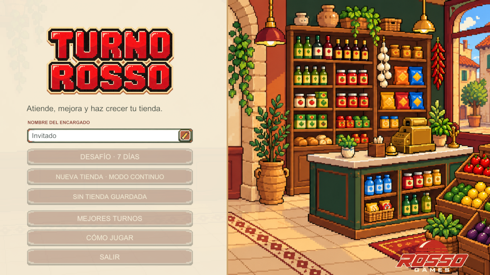
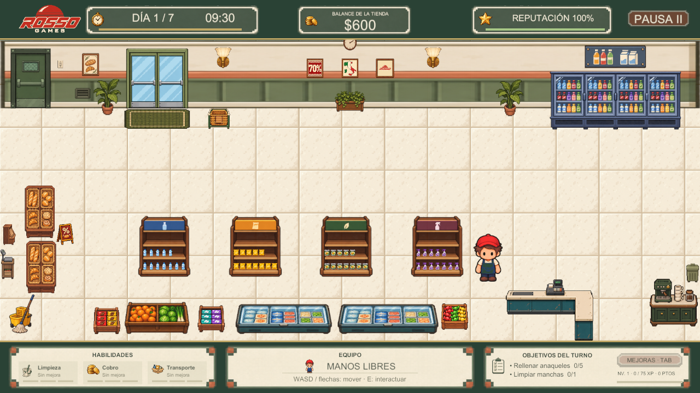
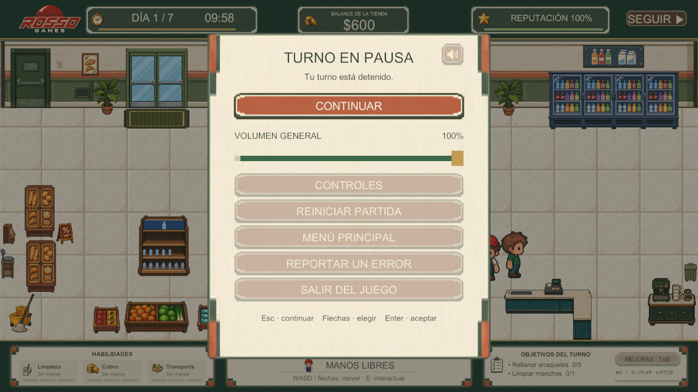
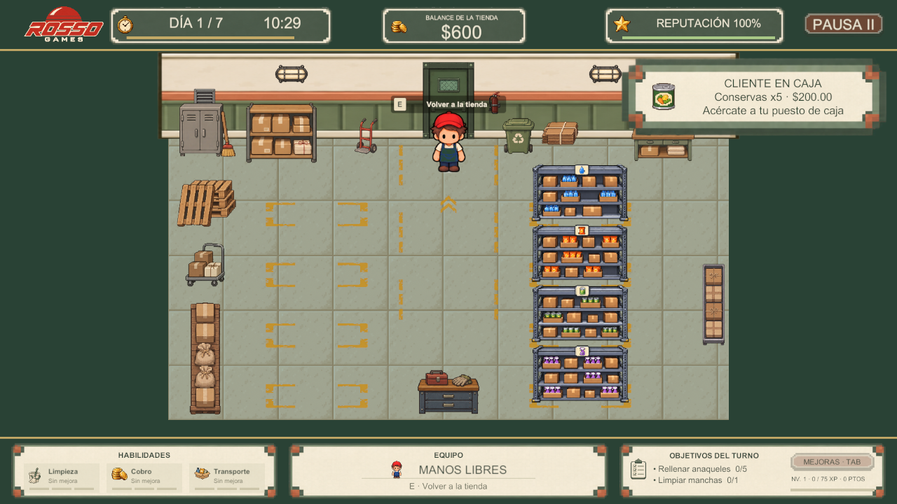
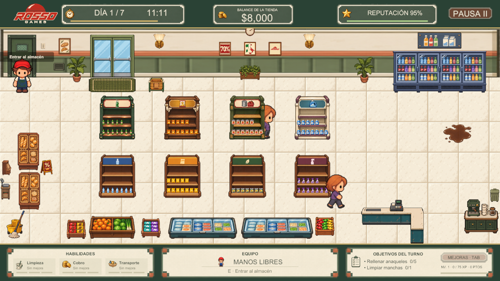
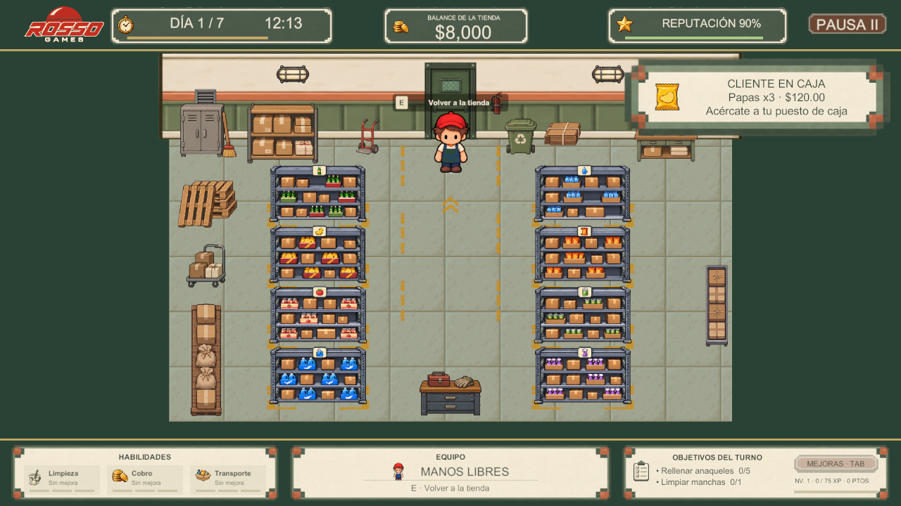
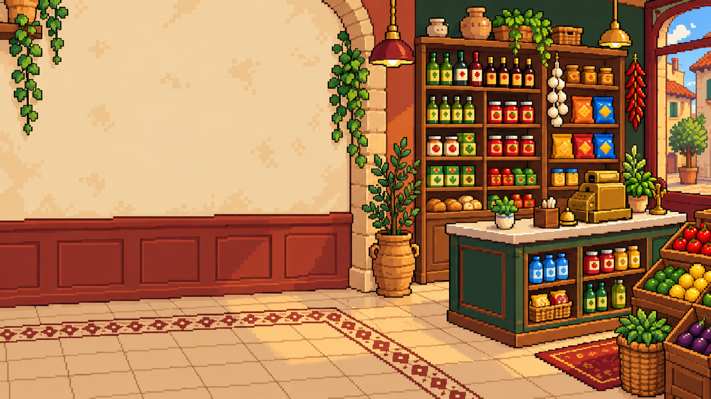

# TURNO ROSSO

## Documento de diseño del videojuego

**GDD 0.3.0 · 9 de noviembre de 2026 · revisión del juego b28eaa1.**

**Responsable:** Lester David Uicab Gongora.  
**Equipo:** Lester David Uicab Gongora; José Ignacio Hernández Pérez; Romel Sebastián Cruz Medina; Karem Vanessa Borges Correa; Jorge Antonio Castañon Uitz; Gabriel Eduardo Ruiz Velasco.

Simulación de gestión de tienda y tiempo · Windows · Un jugador · Pixel art 2D.

Equipo del proyecto: Turno Rosso. Plantilla original: Ing. Luis Fernando Villafaña Rejón.

Esta edición reúne las secciones completas. Las imágenes de assets se distinguen de capturas actuales de ejecución. Las pruebas de distribución pendientes se conservan como tales.

## Contenido

1. [00 - Avance jugable](#seccion-01)
2. [01 - Ficha del Proyecto](#seccion-02)
3. [02 - Visión del Juego](#seccion-03)
4. [03 - Público y Plataforma](#seccion-04)
5. [04 - Pilares de Diseño](#seccion-05)
6. [01 - Jugabilidad](#seccion-06)
7. [02 - Mecánicas](#seccion-07)
8. [03 - Sistemas](#seccion-08)
9. [04 - Controles](#seccion-09)
10. [05 - Progresión](#seccion-10)
11. [06 - Economía y Recursos](#seccion-11)
12. [07 - Reglas y Estados del Juego](#seccion-12)
13. [01 - Premisa y Trama](#seccion-13)
14. [02 - Mundo](#seccion-14)
15. [03 - Personajes](#seccion-15)
16. [04 - Diálogos y Narrativa](#seccion-16)
17. [01 - Estructura del Contenido](#seccion-17)
18. [02 - Niveles](#seccion-18)
19. [03 - Enemigos y NPC](#seccion-19)
20. [04 - Objetos y Coleccionables](#seccion-20)
21. [05 - Misiones y Desafíos](#seccion-21)
22. [01 - Dirección de Arte](#seccion-22)
23. [02 - Personajes y Animación](#seccion-23)
24. [03 - Entornos](#seccion-24)
25. [04 - Interfaz Visual](#seccion-25)
26. [05 - Audio y Música](#seccion-26)
27. [06 - Registro visual](#seccion-27)
28. [01 - UX y Flujo del Jugador](#seccion-28)
29. [02 - UI y Menús](#seccion-29)
30. [03 - Accesibilidad](#seccion-30)
31. [04 - Guardado y Configuración](#seccion-31)
32. [01 - Arquitectura Técnica](#seccion-32)
33. [02 - Motor y Herramientas](#seccion-33)
34. [03 - Requisitos Técnicos](#seccion-34)
35. [04 - Datos y Persistencia](#seccion-35)
36. [05 - Seguridad y Riesgos Técnicos](#seccion-36)
37. [01 - Alcance](#seccion-37)
38. [02 - Roles y Responsabilidades](#seccion-38)
39. [03 - Roadmap](#seccion-39)
40. [04 - Backlog del Proyecto](#seccion-40)
41. [05 - Gestión de Cambios](#seccion-41)
42. [01 - Criterios de Calidad](#seccion-42)
43. [02 - Pruebas](#seccion-43)
44. [03 - Bugs y Seguimiento](#seccion-44)
45. [04 - Criterios de Aceptación](#seccion-45)
46. [01 - Glosario](#seccion-46)
47. [02 - Referencias e Inspiración](#seccion-47)
48. [03 - Registro de Decisiones](#seccion-48)
49. [04 - Historial de Versiones](#seccion-49)
50. [00 - Biblioteca de Clasificación](#seccion-50)
51. [01 - Géneros](#seccion-51)
52. [02 - Subgéneros y Combinaciones](#seccion-52)
53. [03 - Plataformas y Consolas](#seccion-53)
54. [04 - Perspectivas y Cámaras](#seccion-54)
55. [05 - Modos de Juego](#seccion-55)
56. [06 - Clasificaciones y Etiquetas](#seccion-56)

---

# Turno Rosso: avance jugable

**GDD 0.3.0 · 9 de noviembre de 2026 · revisión b28eaa1.**

El encargado atiende una tienda con cuatro productos básicos y puede comprar cuatro anaqueles adicionales, especializarlos y mejorar su eficacia. La bodega separada conserva los sistemas de la tienda activos: ir por cajas deja clientes esperando y obliga a organizar la ruta.

## Recorrido de una sesión

Menú → Invitado o editar nombre → desafío / tienda continua / continuar → tienda y bodega → informe de jornada → siguiente día o resultado.

| Área | Contenido vigente |
| --- | --- |
| Tiempo | Jornadas de cinco minutos; desafío de siete días o continuo |
| Oferta | Agua, Papas, Conservas y Limpiador; Refresco, Gourmet, Despensa+ y Concentrado |
| Suministro | Comprar cajas de cinco desde racks; básicos a derecha y especialidades a izquierda |
| Atención | Tres arquetipos, demanda real, búsqueda de otro anaquel válido, fila y cobro sostenido |
| Vida del local | Visitas ambientales a exhibidores sin venta ficticia de esos artículos |
| Incidencias | Manchas transitables, mopa, supervisor y ladrón |
| Crecimiento | Cuatro extras por $220, especialización con stock conservado, diez niveles y tres habilidades |
| Interfaz | Foco a color, teclado, nombre opcional, progreso circular, pausa y volumen |
| Sonido | Tres pistas y 26 efectos, con grabaciones de acciones físicas |
| Continuidad | Guardado del negocio continuo al cerrar; marcador local |
| Soporte | Reporte de problema a la PWA desde pausa |

## Estado de verificación

La versión pasó por pruebas funcionales antes de su publicación en main. Se verificaron compilación C#, referencias de audio y envío/reintento de reportes a la API. La build Windows, su rendimiento y una matriz de casos de entrega todavía requieren registro específico; no se acredita una build auditada por esa confirmación general.

## Lectura recomendada

[01 - Jugabilidad](02%20-%20Dise%C3%B1o/01%20-%20Jugabilidad.md) → [02 - Mecánicas](02%20-%20Dise%C3%B1o/02%20-%20Mec%C3%A1nicas.md) → [05 - Progresión](02%20-%20Dise%C3%B1o/05%20-%20Progresi%C3%B3n.md) → [06 - Economía y Recursos](02%20-%20Dise%C3%B1o/06%20-%20Econom%C3%ADa%20y%20Recursos.md). Para arte: [02 - Personajes y Animación](05%20-%20Arte%20y%20Audio/02%20-%20Personajes%20y%20Animaci%C3%B3n.md) y [06 - Registro visual](05%20-%20Arte%20y%20Audio/06%20-%20Registro%20visual.md). Para entrega: [02 - Pruebas](09%20-%20Calidad/02%20-%20Pruebas.md) y [04 - Criterios de Aceptación](09%20-%20Calidad/04%20-%20Criterios%20de%20Aceptaci%C3%B3n.md).

---

# Ficha del proyecto

| Campo | Información |
| --- | --- |
| Nombre | Turno Rosso |
| Versión del GDD | 0.3.0 |
| Actualización | 9 de noviembre de 2026 |
| Estado | Versión jugable con pruebas confirmadas por el responsable; preparación de entrega de Windows |
| Responsable | Lester David Uicab Gongora |
| Equipo | Lester David Uicab Gongora; José Ignacio Hernández Pérez; Romel Sebastián Cruz Medina; Karem Vanessa Borges Correa; Jorge Antonio Castañon Uitz; Gabriel Eduardo Ruiz Velasco |
| Género | Simulación de gestión de tienda y gestión del tiempo |
| Plataforma | PC Windows; un jugador |
| Motor | Unity 6000.6.4f1 |
| Lenguaje | C# |
| Perspectiva | 2D superior estilizada; cámara ortográfica |
| Repositorio vigente del juego | https://github.com/nachherp/TurnoRosso |
| Revisión de referencia | b28eaa1: main y develop sincronizadas el 9 de noviembre de 2026 |
| Fecha de inicio | No registrada |
| Distribución | Proyecto académico; entrega gratuita prevista |

## El juego en una frase

Atiende una tienda de conveniencia, abastece ocho posibles anaqueles desde una bodega separada y decide cómo repartir tu tiempo entre clientes, limpieza, caja, inversiones y vigilancia.

## Entrega actual

Incluye desafío de siete días, modo continuo con guardado al cierre, ocho productos, tres habilidades, supervisor, ladrón, música y efectos, menús navegables con teclado y reportes a una PWA. La versión del GDD identifica el documento, no una versión comercial del ejecutable.

La coordinación general corresponde al responsable del proyecto. La distribución específica de las áreas de trabajo está pendiente de confirmación del equipo. Véase [02 - Roles y Responsabilidades](08%20-%20Producci%C3%B3n/02%20-%20Roles%20y%20Responsabilidades.md).

---

# Visión del juego

## Concepto y experiencia

El jugador es el encargado de una tienda de conveniencia. Mantener la atención en caja, reponer mercancía, limpiar y proteger el efectivo compite por un mismo reloj. La tienda continúa operando cuando el jugador visita la bodega; desplazarse tiene un costo de oportunidad real.

La experiencia deseada combina la satisfacción de ordenar y vender con presión moderada: una ruta bien elegida permite atender más tareas, y una inversión o habilidad reduce el esfuerzo de jornadas posteriores.

## Propuesta de valor

- Operación directa del negocio mediante movimiento e interacción contextual.
- Dos espacios conectados: tienda y bodega de racks, con inventarios compartidos.
- Cuatro anaqueles básicos y cuatro adicionales que pueden evolucionar a especialidades.
- Clientes con preferencias y reacciones, supervisor e intentos de robo.
- Desafío semanal o negocio continuo con guardado local.

## Modos

**Desafío · 7 días:** completar siete jornadas de cinco minutos activos sin perder toda la confianza. El cierre final produce un rango y una recompensa ficticia según la eficiencia.

**Modo continuo:** continuar después del séptimo día con el perfil de dificultad del día siete. Se guarda el negocio al cierre; no se recupera un turno abandonado a la mitad.

## Alcance de la visión

La prioridad es que cada tarea y consecuencia sea comprensible. No incluye multijugador, combate, construcción libre ni una simulación contable realista. Las visitas al café y exhibidores dan vida al local, pero no añaden ventas de esos artículos.

---

# Público y plataforma

## Público

Jugadores casuales e intermedios que disfrutan organizar tareas, administrar recursos y mejorar un negocio. La orientación de diseño es aproximadamente 13 años en adelante por la lectura y priorización necesarias; no es una clasificación oficial. Hay robo ficticio, sin violencia gráfica.

No se requieren conocimientos de comercio. La pantalla Cómo jugar presenta movimiento, interacción, almacén, limpieza, cobro, mejoras y pausa.

## Plataforma y sesión

| Aspecto | Decisión |
| --- | --- |
| Principal | Windows para PC |
| Control | Teclado: WASD/flechas, E/Espacio, Q/G, Tab, Enter y Esc; mouse alternativo en interfaz |
| Interfaz de referencia | 1280 × 720, 16:9 |
| Resolución adicional a validar | 1920 × 1080 |
| Duración | 5 minutos activos por jornada; 35 minutos para siete jornadas, más pausas y resúmenes |
| Internet | No necesario para jugar o guardar localmente; necesario para enviar reportes a la PWA |
| Rendimiento objetivo | 60 FPS, sujeto a medición del ejecutable |

No se certifican CPU, GPU o RAM mínimos sin mediciones. Móvil, consola y soporte completo de mando quedan fuera de la entrega actual. No hay tienda digital ni fecha comercial de lanzamiento confirmadas.

---

# Pilares de diseño

## 1. Priorizar bajo presión

El mismo encargado cobra, compra cajas, rellena anaqueles y limpia. Abandonar la tienda para entrar a la bodega no detiene a los clientes. Las jornadas de 300 segundos obligan a decidir qué tarea resuelve el riesgo más inmediato.

## 2. Consecuencias legibles

La falta de producto provoca pérdida de ventas; la espera puede reducir confianza; el robo afecta efectivo y confianza; las infracciones detectadas por el supervisor generan multas. El HUD, las reacciones y los informes deben permitir entender la causa.

## 3. Crecimiento tangible

Vender y trabajar produce experiencia. El dinero compra anaqueles extra y su especialización; los puntos de nivel mejoran limpieza, cobro y transporte. Cada mejora debe apreciarse en el uso, el producto y el mobiliario.

## 4. Coherencia visual y espacial

Personajes y muebles comparten pixel art, escala y perspectiva. Los colliders deben impedir atravesar mobiliario sin bloquear pasillos. Una pose cargada o de limpieza no debe encoger al personaje.

## Criterio para cambios

Una función nueva debe apoyar la operación del negocio, ser legible y respetar las rutas. Se priorizan interacción, claridad y estabilidad sobre añadir decoración que estorbe. Se mantiene la identidad de ROSSO GAMES.

---

# Jugabilidad

## Bucle principal

Observar tienda y HUD → elegir prioridad → desplazarse → interactuar → comprobar resultado → cobrar o invertir → preparar la siguiente jornada.

| Acción | Condición | Resultado |
| --- | --- | --- |
| Comprar caja | Manos libres, dinero y reserva disponibles | Pago de cinco unidades y caja equipada |
| Rellenar | Caja del producto correcto y anaquel con espacio | Transferencia hasta llenar o agotar la caja |
| Limpiar | Mopa equipada y mancha cercana | Mantener interacción hasta eliminarla |
| Cobrar | Manos libres, puesto de caja y cliente listo | Mantener interacción hasta registrar la venta |
| Vigilar | Ocupar el puesto antes de completarse el robo | El ladrón abandona el intento |
| Mejorar | Dinero o puntos suficientes | Mayor oferta o eficiencia de trabajo |

## Ritmo

Al comenzar hay cuatro anaqueles básicos con 12/20 unidades. La demanda va consumiendo mercancía y se forma una fila de hasta seis puestos. El jugador alterna recorridos a bodega y atención; las manchas y visitas añaden urgencia. Las compras de mejoras permiten preparar el negocio sin recurrir a construcción libre.

Los clientes pueden visitar uno o dos exhibidores decorativos antes del anaquel. Esas paradas son una representación ambiental: el ticket solo incorpora producto real del anaquel.

## Cierre

Al agotarse el reloj no entran nuevas operaciones. Un cobro ya iniciado y válido puede terminar dentro de una tolerancia de tres segundos. El resumen muestra ventas, pérdidas y gastos; desde él se continúa al día siguiente o al resultado semanal.

La derrota depende de confianza cero, no de quedarse momentáneamente sin efectivo. El modo continuo no termina por alcanzar el día siete.

---

# Mecánicas

## Movimiento y equipo

WASD o flechas mueven al encargado en ocho direcciones. En la escena Game la velocidad base es 2.3 unidades/s; llevar caja aplica 0.75 antes de la habilidad de transporte. Solo puede sostener una caja o la mopa. Q o G sueltan el objeto en una posición libre del suelo; un intento de soltar sin espacio no debe perderlo.

## Cajas y reposición

Cada rack vende cajas de cinco unidades de un producto. Exige manos libres, existencias, dinero suficiente y no tener otra caja del mismo producto abandonada fuera. El costo se descuenta al retirar la caja y las unidades dejan la reserva.

E o Espacio sobre un anaquel compatible transfiere `min(espacio libre, unidades de caja)` en una interacción. Si sobran unidades permanecen en la caja; si queda vacía se consume. **La reposición actual es instantánea por pulsación**, no una transferencia animada unidad a unidad. El anaquel no acepta otra categoría ni otro producto básico/especialidad de la misma categoría.

## Limpieza

La mopa se recoge en la tienda. Con ella se puede caminar sobre la mancha y mantener E o Espacio para limpiarla. Base del prefab: 2 s; duración efectiva `2 / (1 + 0.15 × rango de limpieza)`. Soltar la interacción cancela el proceso; el sonido se detiene al cancelar o completar.

## Cobro

El encargado debe estar en su puesto, con manos libres y un ticket listo. Mantener E o Espacio completa el cobro; base 1.5 s y duración efectiva `1.5 / (1 + 0.10 × rango de cobro)`. No es automático por proximidad. El progreso se representa con un círculo.

## Puertas, pausa y mejoras

La puerta industrial a bodega exige E. El acceso de clientes responde a su circulación. Esc pausa o vuelve desde una subvista. Tab abre y cierra Anaqueles, Ampliación y Habilidades. La pausa detiene la simulación; visitar el almacén no la pausa.

## Seguridad

La presencia del encargado en el puesto evita que el ladrón continúe robando. La regla actual no usa combate ni una acción de captura con E; un robo completado sustrae el efectivo disponible. Véase [03 - Enemigos y NPC](04%20-%20Contenido/03%20-%20Enemigos%20y%20NPC.md).

---

# Sistemas

| Sistema | Entrada | Transformación | Salida |
| --- | --- | --- | --- |
| Jornada | Modo, día y reloj | Simulación de 300 s y cierre | Informe diario o resultado final |
| Demanda | Arquetipo y productos instalados | Selección ponderada, visita y búsqueda de stock | Ticket o abandono |
| Fila y caja | Cliente con mercancía | Espera y cobro manual | Venta, salida o descontento |
| Inventario | Reservas, dinero y cajas | Compra y transferencia compatible | Stock visible de anaquel |
| Limpieza | Mopa, proximidad e interacción sostenida | Progreso de limpieza | Mancha eliminada y XP |
| Supervisión | Confianza y estado del local | Visita e infracciones observadas | Multas y confianza perdida |
| Robo | Caja sin atender y temporizador | Intento, sustracción y huida | Pérdida económica y reputacional |
| Progresión | Ventas y tareas | Experiencia, niveles y puntos | Habilidades e inversión en anaqueles |
| Persistencia | Cierre de modo continuo | JSON local validado | Continuación al siguiente día |
| Audio | Eventos y posición respecto a cámara | Mezcla y prioridad | Música contextual y efectos |
| Reportes | Título y descripción voluntarios | Envío HTTPS | Reporte de Juego en la bandeja de la PWA |

## Acoplamiento

Los componentes comparten eventos de inicio/cierre, venta, limpieza, reposición e inspección. La bodega se carga de forma aditiva y conserva los gestores de la tienda. No hay un segundo reloj ni un segundo inventario independiente.

## Decisiones de integración

Los clientes buscan otro anaquel con el mismo producto cuando el primero está vacío. Agua y Refresco son productos diferentes: no se sustituyen solo por pertenecer a bebidas. Los artículos de exhibición no generan tickets ficticios. Los paneles detienen o permiten interacción según el estado global y la disponibilidad real.

---

# Controles

| Contexto | Entrada | Acción |
| --- | --- | --- |
| Juego | W, A, S, D o flechas | Mover al encargado |
| Interacción cercana | E o Espacio | Recoger caja/mopa o rellenar un anaquel compatible |
| Con mopa, junto a mancha | Mantener E o Espacio | Limpiar |
| Puesto de caja y ticket | Mantener E o Espacio | Cobrar |
| Puerta de bodega | E | Entrar o volver a tienda |
| Objeto en manos | Q o G | Dejarlo en una posición libre |
| Mejoras | Tab | Abrir/cerrar mejoras |
| Menús | Flechas | Mover selección |
| Menús | Enter | Aceptar opción seleccionada |
| Partida o subvista | Esc | Pausar, regresar o cerrar panel según contexto |
| Nombre del encargado | Lápiz y Enter | Habilitar edición y confirmar nombre |
| Nombre en edición | Esc | Cancelar edición y recuperar el nombre anterior |
| Reporte | Tab / Mayús + Tab | Recorrer campos y botones |
| Reporte, descripción | Enter | Salto de línea durante edición |

## Reglas de presentación

El nombre inicial es Invitado; no se exige escribir para jugar. Las teclas WASD aparecen como cuatro teclas individuales en Cómo jugar. El foco de menú se muestra con color completo y borde; las demás opciones permanecen atenuadas. El mouse permite usar los mismos botones.

La burbuja E solo representa una interacción posible en ese momento. No debe anunciar cobro sin ticket ni reposición sin caja compatible. No hay salto, ataque, cámara libre ni control táctil.

---

# Progresión

## Experiencia y niveles

Se empieza en nivel 1 y el máximo es 10. El requisito para subir desde nivel `n` es `75 + 25 × (n − 1)` XP. El excedente se conserva al subir; al nivel 10 deja de acumularse. Cada nivel concede un punto y hay nueve puntos posibles.

| Fuente | Experiencia |
| --- | ---: |
| Venta cobrada | Máximo entre 4 y redondeo hacia arriba del importe / 15 |
| Reposición de un anaquel | 3 |
| Mancha eliminada | 8 |
| Inspección con infracciones | 5 |
| Inspección sin infracciones | 25 |
| Cierre diario | 20 |
| Completar todos los objetivos diarios | 25, una vez por jornada |

## Habilidades

Cada rango cuesta un punto; cada habilidad tiene tres rangos.

| Habilidad | Efecto por rango | Aplicación |
| --- | --- | --- |
| Limpieza | +15% al factor de eficacia | Divide la duración base de limpieza entre `1 + 0.15r` |
| Cobro | +10% al factor de eficacia | Divide duración base de cobro entre `1 + 0.10r` |
| Transporte | +8% al factor de velocidad con caja | Multiplica 0.75 por `1 + 0.08r`, con tope de 1 |

Las habilidades se aplican pasivamente; no necesitan otro botón de activación. El HUD inferior izquierdo presenta las adquiridas.

## Anaqueles

La tienda comienza con cuatro básicos. Se compra un extra por categoría por $220, hasta ocho en total, sin pagar una apertura previa del local. El extra empieza vacío con el producto básico correspondiente. Después puede mejorar a Refresco, Gourmet, Despensa+ o Concentrado; conserva la cantidad existente y cambia ese stock al nuevo producto. El básico permanece disponible en su anaquel original.

La mejora desbloquea un rack propio en bodega. Los campos de nivel recomendado 2/3 del catálogo no son un bloqueo actual: la compra exige anaquel instalado y dinero, no subir de nivel.

## Dificultad y resultado

Los perfiles diarios acortan los intervalos de clientes, suciedad, robos e inspecciones. El continuo reutiliza el perfil del día siete. El desafío produce rango S (≥90% eficiencia), A (≥75%), B (≥60%) o C (<60%). Véase [02 - Niveles](04%20-%20Contenido/02%20-%20Niveles.md).

---

# Economía y recursos

## Estado inicial y límites

| Recurso | Valor actual |
| --- | --- |
| Efectivo inicial | $600, pesos del juego |
| Confianza | 100; rango de 0 a 100 |
| Anaqueles iniciales | Cuatro; 12 unidades por anaquel, capacidad de 20 |
| Reservas iniciales | 30 por producto básico; 120 unidades básicas en total |
| Reabastecimiento diario | +10 por producto desbloqueado desde el día 2, hasta 30 por producto |
| Caja de mercancía | Cinco unidades; un objeto en manos |
| Extra de anaquel | $220 por categoría; máximo cuatro extras |

## Catálogo y márgenes

Los importes son por unidad, salvo costo de caja y mejora. Margen bruto unitario es venta menos costo; no descuenta pérdidas ni multas.

| Producto | Venta | Costo/unidad | Caja de 5 | Margen/unidad | Mejora del extra | Peso de demanda |
| --- | ---: | ---: | ---: | ---: | ---: | ---: |
| Agua | $40 | $12 | $60 | $28 | — | 1.00 |
| Papas | $40 | $14 | $70 | $26 | — | 1.00 |
| Conservas | $40 | $16 | $80 | $24 | — | 1.00 |
| Limpiador | $40 | $18 | $90 | $22 | — | 1.00 |
| Refresco | $72 | $28 | $140 | $44 | $220 | 0.65 |
| Gourmet | $78 | $30 | $150 | $48 | $260 | 0.60 |
| Despensa+ | $88 | $35 | $175 | $53 | $300 | 0.55 |
| Concentrado | $100 | $40 | $200 | $60 | $340 | 0.50 |

El peso es relativo entre productos elegibles, no una probabilidad porcentual garantizada. La mercancía se paga al comprar la caja. Un rack agotado no vende hasta el suministro siguiente. Desbloquear una especialidad concede su reserva inicial de 30 unidades.

## Pérdidas y confianza

Un robo completado toma todo el efectivo disponible y resta 50 de confianza una sola vez, incluso si la caja estaba sin dinero. No existe recuperación del robo mediante una captura posterior. Una espera agotada penaliza 5 de confianza. La inspección detecta manchas y anaqueles críticos (≤2 unidades): resta 5/10 de confianza y multa $20/$40 respectivamente por infracción. La multa no crea deuda; se limita al efectivo disponible. Al comenzar otro día se recuperan hasta 10 de confianza, sin superar 100.

## Indicadores del informe

`Neto = ventas − robos − multas − suministros`. Las inversiones se muestran aparte y sí reducen el efectivo. `Eficiencia = (ventas − robos − multas) / ventas potenciales × 100`, limitada a 0–100; con demanda cero da 0. No debe confundirse eficiencia con margen ni efectivo con ventas.

---

# Reglas y estados del juego

| Estado | Simulación | Salida |
| --- | --- | --- |
| Playing | Reloj y sistemas activos | Pausa, cierre o confianza cero |
| Paused | Tiempo de juego detenido | Continuar, controles, reporte, reiniciar, menú o salir |
| Closing | Tienda congelada; solo puede terminar el cobro permitido | Resumen al completar/cancelar o agotar tolerancia |
| DaySummary | Informe y simulación detenida | Siguiente jornada o victoria del desafío |
| Won | Resultado final | Nueva partida o menú |
| Lost | Despido y resultado final | Reintentar o menú |

## Cierre

Cada jornada tiene 300 segundos activos. Si al sonar el cierre ya se estaba cobrando un ticket válido, con cajero presente y espera disponible, se concede hasta tres segundos medidos con tiempo no escalado. No sirve para comenzar otro cobro. Terminado ese caso se produce el resumen.

En desafío, continuar desde el resumen del séptimo día lleva a victoria si queda confianza. En continuo comienza el día siguiente sin un final semanal obligatorio.

## Invariantes

- Una venta se registra una vez y solo por la cantidad efectivamente retirada.
- Un cliente no debe irse por un anaquel vacío si existe otro accesible con su mismo producto.
- Manos: caja, mopa o libres; nunca ambos objetos a la vez.
- Un anaquel acepta su producto exacto; básico y especialidad no son intercambiables.
- Confianza cero causa derrota; efectivo cero no la causa por sí solo.
- Visitar Warehouse no crea otra partida ni pausa la tienda.
- Las compras no permiten saldo negativo.

## Resultado semanal

La eficiencia determina rango y recompensa ficticia: S recibe PC Gamer Monster Beast; A/B una PC Gamer Gama Media; C una Computadora de Oficina Usada. No se trata de un premio físico ni una compra real.

---

# Premisa y trama

## Premisa

Un encargado sostiene una tienda de conveniencia mientras los clientes, el desorden, un ladrón y las revisiones del dueño compiten por su atención. Su objetivo es demostrar que puede mantener el negocio durante una semana o hacerlo crecer en modo continuo.

## Desarrollo

Los primeros días introducen las rutas entre caja, anaqueles y bodega. Al aumentar la afluencia, el jugador debe invertir y anticipar la falta de mercancía. Las habilidades convierten el trabajo realizado en una mayor capacidad para atender tareas.

El conflicto es operativo: no puede estar cobrando y comprando suministros al mismo tiempo. El supervisor evalúa el estado del local; el ladrón aprovecha la caja desatendida.

## Resolución

En desafío, completar siete jornadas con confianza produce un informe, rango y recompensa ficticia. Perder toda la confianza causa despido. En continuo, cerrar una jornada permite seguir con el negocio y conservar progreso.

La historia se transmite mediante acciones, avisos y resultados. No hay una campaña dialogada, cinemáticas narrativas ni finales secretos definidos.

---

# Mundo

## Contexto

Tienda ficticia contemporánea con identidad italiana sugerida por el nombre, la paleta y la decoración. No se fija una ciudad o una fecha narrativa. La versión actual representa los importes con pesos ($); la identidad visual no obliga a usar euros.

## Espacios

| Espacio | Contenido | Función |
| --- | --- | --- |
| Tienda | Anaqueles básicos y extra, mostrador en L, exhibidores, refrigeradores y café | Atención, venta real de anaqueles y visitas ambientales |
| Bodega | Racks, mesa de recepción, almacenamiento, carro de carga, armario y marcas de suelo | Comprar y recoger cajas de productos |
| Acceso de clientes | Puerta doble, tapete y soporte de canastas | Entrada/salida y lectura del local |
| Puerta industrial | Conexión con bodega | Cambio de área mediante E |
| Puesto del encargado | Zona tras mostrador en L | Cobro y prevención del robo |
| Limpieza | Mopa accesible en tienda | Mantenimiento del piso |

## Reglas espaciales

Los racks de especialidades están a la izquierda de la bodega y los básicos a la derecha; el pasillo central comunica puerta y zona de trabajo. El mobiliario tiene colisión y una huella congruente con el personaje. Los clientes pueden atravesarse entre sí para evitar bloqueos, pero no deben atravesar los muebles.

La bodega pertenece a una escena diferente cargada aditivamente. El exterior queda fuera del área jugable. La tienda mantiene actividad mientras el jugador está en el almacén.

---

# Personajes

## Encargado

Único personaje controlable. Su gorra roja y ropa de trabajo facilitan reconocerlo entre clientes. Empieza como Invitado; el lápiz del menú permite cambiar el nombre del marcador. Su motivación es mantener servicio y confianza. Progresa mediante experiencia y habilidades de limpieza, cobro y transporte.

No tiene vida física, armas ni ataques. Las manos limitadas y el tiempo son sus restricciones principales.

## Clientes

Tres arquetipos con variantes visuales. Sus preferencias son funcionales, no biografías:

| Arquetipo | Productos elegibles por categoría | Cantidad deseada |
| --- | --- | --- |
| Vecino | Conservas y limpieza, incluidas especialidades de esas categorías | 4–6 unidades |
| Estudiante | Bebidas y snacks | 3–5 unidades |
| Oficinista | Bebidas y snacks | 2–3 unidades |

Pueden detenerse frente a pan, refrigeradores, café u otros exhibidores; luego buscan su producto, compran, esperan, pagan y salen. Las burbujas comunican curiosidad, espera y enfado.

## Dueño / supervisor

Don Rosso representa la evaluación del trabajo. Se desplaza por el local, observa manchas y anaqueles críticos y comunica infracciones. No es un jefe de combate. Menor confianza acelera sus visitas.

## Ladrón

Amenaza económica diferenciada por ropa oscura. Se dirige a caja, intenta sustraer el efectivo y huye. Ocupar el puesto a tiempo evita el intento. No hay captura física ni combate.

No se han fijado apellidos, parentescos, edades o historias individuales adicionales.

---

# Diálogos y narrativa

## Canales

Avisos breves, burbujas de clientes, instrucciones, mensajes de inspección, reportes diarios y pantalla de despido. La situación de trabajo transmite la historia sin conversaciones ramificadas.

| Evento | Mensaje o intención | Respuesta |
| --- | --- | --- |
| Cliente en caja | Ticket con producto, cantidad e importe | Acudir al puesto y mantener interacción |
| Inspección | Aviso y resultado de revisión | Limpiar y evitar anaqueles críticos |
| Robo | Alerta y temporizador | Volver a ocupar caja antes de completarse |
| Falta de recursos | Motivo de interacción bloqueada | Elegir otra tarea o esperar suministro |
| Subida de nivel | Nivel y puntos disponibles | Elegir habilidad en Tab |
| Cierre | Ventas, pérdidas, gastos y confianza | Evaluar y continuar |
| Despido | Resultado de la partida | Reintentar o regresar |

## Tono y localización

Español cotidiano y directo. Se usa Rellenar para explicar el objetivo de anaqueles y se diferencia caja de mercancía de registradora. Los textos deben caber sin recortes y conservar acentos.

No hay narrador ni doblaje de diálogos. La vocalización de cliente enojado es un efecto de reacción, no un sistema de conversación. Las decisiones son operativas y afectan recursos, no ramas de historia.

---

# Estructura del contenido

## Organización jugable

| Capa | Contenido |
| --- | --- |
| Acceso | Menú, nombre opcional, modos, mejores turnos y Cómo jugar |
| Local | Sala de ventas y bodega conectadas |
| Oferta | Cuatro productos básicos y cuatro especialidades |
| Servicio | Clientes, fila, cobro y visitas ambientales |
| Incidencias | Manchas, robo e inspecciones |
| Crecimiento | Cuatro anaqueles extra, tres habilidades y diez niveles |
| Evaluación | Objetivos diarios, informe, eficiencia, rango y despido |
| Continuidad | Guardado de tienda continua al cerrar jornada |
| Soporte | Volumen, silencio y reporte de errores a la PWA |

## Ritmo y reutilización

No son siete mapas: los días reutilizan tienda y bodega, con perfiles de eventos más exigentes. Los básicos permiten jugar desde el comienzo; los extras amplían oferta y especialización sin quitar los productos originales.

La decoración incluye pan, golosinas, frutas, congeladores, refrigeradores, café, canastas, carteles y plantas. Su presencia no implica ventas adicionales. Se retiraron mesa, sillas y la mecánica de sentarse; no forman parte del contenido actual.

La referencia de cada elemento aparece en [04 - Objetos y Coleccionables](04%20-%20Contenido/04%20-%20Objetos%20y%20Coleccionables.md) y [06 - Registro visual](05%20-%20Arte%20y%20Audio/06%20-%20Registro%20visual.md).

---

# Niveles

## Espacios de juego

Game contiene la tienda, los gestores y el jugador. Warehouse es una escena de bodega cargada aditivamente al cruzar su puerta. MainMenu contiene el acceso a modos e instrucciones. La lista de compilación conserva ese orden y las tres escenas activadas.

## Jornadas y dificultad

Todas duran 300 s de juego activo. Valores del recurso `DailyDifficultySettings.asset`; intervalos en segundos. La espera de visita es base a confianza 100: la confianza baja puede acortarla, con mínimo de 20 s.

| Día | Clientes cada | Suciedad cada | Manchas máx. | Robo cada | Intentos de robo máx. | Supervisor cada |
| --- | --- | --- | ---: | --- | ---: | --- |
| 1 | 14–18 | 45–60 | 2 | 150–190 | 1 | 180–210 |
| 2 | 12–16 | 40–55 | 2 | 120–150 | 1 | 150–180 |
| 3 | 11–14 | 35–50 | 3 | 80–100 | 2 | 90–110 |
| 4 | 10–12 | 30–45 | 4 | 60–80 | 3 | 75–95 |
| 5 | 9–11 | 25–40 | 4 | 45–60 | 4 | 60–80 |
| 6 | 8–10 | 25–35 | 5 | 40–50 | 5 | 50–65 |
| 7 | 7–9 | 20–30 | 5 | 30–40 | 6 | 45–60 |

El límite configurado del generador es seis clientes activos y la fila tiene seis puestos. Los intervalos no garantizan un número exacto de eventos: influyen el límite activo, la disponibilidad y la duración de cada visita. El continuo usa desde el día ocho los valores del séptimo.

## Distribución

La tienda deja libre el recorrido acceso–anaqueles–fila y separa el puesto tras el mostrador en L. La bodega organiza básicos a la derecha, especialidades a la izquierda y pasillo central. Muebles de trabajo ocupan bordes; las marcas amarillas ayudan a leer circulación y almacenamiento. No hay colocación libre de objetos por el jugador.

---

# Enemigos y NPC

## Cliente

Secuencia principal: entrar → visitar exhibidores opcionales → buscar producto → retirar mercancía → formar fila → esperar cobro → salir. Puede retirarse molesto si no encuentra stock válido o agota la espera. El ticket contiene solo la cantidad retirada y su precio real.

Los arquetipos Vecino, Estudiante y Oficinista restringen categorías y cantidades; véase [03 - Personajes](03%20-%20Historia%20y%20Mundo/03%20-%20Personajes.md). El producto se escoge entre oferta instalada elegible. Al acercarse a un anaquel vacío debe buscar otro accesible con el mismo producto antes de desistir. La demanda potencial se registra una vez al entrar, incluso si no se concreta la venta.

Las visitas al café, pan y refrigeradores son ambientales: no consumen esos sprites ni elevan el ticket. No hay clientes sentados.

## Ladrón

Estados: aproximación → robo → huida → salida. Su temporizador base de código es 4 s, configurable en prefab. Si el cajero ocupa el puesto al aproximarse o durante el intento, huye. Al completar el robo sustrae todo el efectivo disponible y aplica −50 de confianza una vez; la caja vacía no evita la pérdida de confianza. No hay barra de vida ni recompensa por capturarlo.

## Supervisor

Entra, recorre puntos de inspección, comprueba su entorno y sale. Cada mancha o anaquel crítico observado se registra una vez por visita. Criterio crítico: dos unidades o menos. Multas: $20 por mancha y $40 por anaquel crítico; confianza: −5 y −10 respectivamente. No es una multa fija que aumente automáticamente cada día.

La periodicidad depende del perfil diario y de la confianza actual: menor confianza implica visitas más frecuentes. No hay combate ni jefes.

---

# Objetos y coleccionables

## Mercancía

| Categoría | Básico | Especialidad | Representación |
| --- | --- | --- | --- |
| Bebidas | Agua | Refresco | Botella de agua / botella de refresco |
| Snacks | Papas | Gourmet | Bolsa básica / bolsa especial |
| Abarrotes | Conservas | Despensa+ | Conserva / surtido de despensa |
| Limpieza | Limpiador | Concentrado | Atomizador / envase de concentrado |

Cada producto tiene icono, precio y reserva independientes. Las especialidades añaden caja, rack y anaquel visualmente propios. Los precios se concentran en [06 - Economía y Recursos](02%20-%20Dise%C3%B1o/06%20-%20Econom%C3%ADa%20y%20Recursos.md).

## Objetos de uso

| Objeto | Regla |
| --- | --- |
| Caja | Compra de cinco unidades; conserva sobrante tras rellenar; puede soltarse |
| Mopa | Herramienta de tienda; permite limpiar mientras se mantiene la interacción |
| Anaquel básico | Cuatro iniciales, capacidad 20, no se mejora |
| Anaquel extra | Uno por categoría; compra $220 y mejora individual opcional |
| Rack | Dispensador de cajas del producto, condicionado por reserva y dinero |
| Registradora | Ticket y cobro manual desde el puesto |
| Puerta de bodega | Interacción E y cambio de área |
| Mancha | Superficie transitable; no debe impedir caminar ni bloquear acceso a limpieza |

## Utilería

Exhibidores de panes, golosinas y fruta; refrigeradores; congeladores; café; tapete; soporte de canastas; plantas; luminarias; reloj; carteles; almacenamiento y mesa de trabajo en bodega. Las colisiones protegen las huellas de los muebles. Café y otros exhibidores sirven de puntos de visita, sin inventario comercial propio.

No existe colección de objetos raros. La computadora del resultado semanal es una recompensa narrativa en la interfaz, no un objeto utilizable ni entregable físico.

---

# Misiones y desafíos

## Objetivo global

Completar siete jornadas conservando confianza en desafío, o mantener el negocio durante tantas jornadas como sea posible en continuo.

## Objetivos diarios actuales

| Objetivo | Meta de escena | Cómo progresa |
| --- | ---: | --- |
| Rellenar anaqueles | 5 | Cada interacción de reposición válida |
| Limpiar manchas | 1 | Cada mancha eliminada |

`ObjectiveManager` reconstruye estos objetivos al comenzar el día. La configuración actual no aumenta sus metas automáticamente con el día. Completar ambos concede 25 XP una sola vez por jornada. No completarlos no bloquea el cierre ni provoca por sí solo la derrota.

## Desafíos emergentes

- Cobrar antes de agotar paciencia sin abandonar definitivamente limpieza y suministro.
- Mantener producto en anaqueles que comparten demanda.
- Elegir cuándo comprar otro anaquel y cuándo especializarlo.
- Llegar a caja antes del robo mientras se prepara una inspección.
- Mejorar eficiencia al final de la semana.

No hay misiones con diálogo, rutas secundarias, combate o recompensas de campaña adicionales. Las metas orientan el trabajo sin sustituir la evaluación de confianza y economía.

---

# Dirección de arte

## Identidad

Pixel art 2D cálido: paredes crema, revestimiento salvia, madera, metal y acentos terracota/rojos. El título Turno Rosso utiliza letras rojas de bloque, borde oscuro y contorno claro; ROSSO GAMES mantiene su identidad gráfica.

La perspectiva es superior estilizada, con frente y superficie de muebles dibujados para leer su volumen. No se rota un sprite frontal 90 grados para fingir otra vista: los objetos laterales requieren dibujo con perspectiva propia.

## Escala y legibilidad

El personaje es la referencia. Puertas permiten su paso, tiradores y superficies quedan a altura creíble y los productos se leen como unidades pequeñas. Un cambio de pose, recorte o equipo no debe reducir la altura del personaje. Los sprites transparentes no deben arrastrar fondo de la hoja.

Anaqueles básicos y especialidades se diferencian por silueta, detalles e iconos, además del color. Los racks de bodega usan metal y cajas para distinguir almacenamiento de exhibición al público.

## Reglas de integración

Importación Point cuando corresponda, transparencia y pivotes revisados, orden de render por apoyo en suelo y colliders ajustados a la huella. No se estira el arte de forma no uniforme para cubrir espacio. La decoración respeta pasillos y no tapa interacciones.

El mobiliario de café no incluye mesa ni sillas: esos elementos y el sistema de sentarse se retiraron del alcance.

---

# Personajes y animación

## Recursos comprobados

Las imágenes de esta sección se extrajeron de los sprites referenciados por los clips del proyecto abierto en Unity el 9 de noviembre de 2026. Los GIFs reproducen sus fotogramas y tiempos de clave, alineados por el pivote exportado del sprite. Son previsualizaciones de los clips, no capturas de movimiento en la escena: la velocidad del Animator y los ajustes de apoyo del actor pueden modificar la presentación durante el juego.

No se utilizan hojas de personajes de otra versión. Las capturas de la partida actual están en [Registro visual](05%20-%20Arte%20y%20Audio/06%20-%20Registro%20visual.md).

| Personaje | Sprite de referencia | Función |
| --- | --- | --- |
| Encargado | ![[Media/Revision_2026-11-09/Player.png\|100]] | Jugador, cajas y limpieza |
| Cliente 01 | ![[Media/Revision_2026-11-09/Customer01.png\|100]] | Comprador |
| Cliente 02 | ![[Media/Revision_2026-11-09/Customer02.png\|100]] | Comprador |
| Cliente 03 | ![[Media/Revision_2026-11-09/Customer03.png\|100]] | Comprador |
| Supervisor | ![[Media/Revision_2026-11-09/Owner.png\|100]] | Inspección |
| Ladrón | ![[Media/Revision_2026-11-09/Thief.png\|100]] | Intento de robo y huida |

## Caminatas del proyecto

| Personaje | Frente | Espalda | Izquierda | Derecha |
| --- | --- | --- | --- | --- |
| Encargado | ![[Media/Revision_2026-11-09/Player_Walk_Down.gif\|100]] | ![[Media/Revision_2026-11-09/Player_Walk_Up.gif\|100]] | ![[Media/Revision_2026-11-09/Player_Walk_Left.gif\|100]] | ![[Media/Revision_2026-11-09/Player_Walk_Right.gif\|100]] |
| Cliente 01 | ![[Media/Revision_2026-11-09/Customer01_Walk_Down.gif\|100]] | ![[Media/Revision_2026-11-09/Customer01_Walk_Up.gif\|100]] | ![[Media/Revision_2026-11-09/Customer01_Walk_Left.gif\|100]] | ![[Media/Revision_2026-11-09/Customer01_Walk_Right.gif\|100]] |
| Cliente 02 | ![[Media/Revision_2026-11-09/Customer02_Walk_Down.gif\|100]] | ![[Media/Revision_2026-11-09/Customer02_Walk_Up.gif\|100]] | ![[Media/Revision_2026-11-09/Customer02_Walk_Left.gif\|100]] | ![[Media/Revision_2026-11-09/Customer02_Walk_Right.gif\|100]] |
| Cliente 03 | ![[Media/Revision_2026-11-09/Customer03_Walk_Down.gif\|100]] | ![[Media/Revision_2026-11-09/Customer03_Walk_Up.gif\|100]] | ![[Media/Revision_2026-11-09/Customer03_Walk_Left.gif\|100]] | ![[Media/Revision_2026-11-09/Customer03_Walk_Right.gif\|100]] |
| Supervisor | ![[Media/Revision_2026-11-09/Owner_Walk_Down.gif\|100]] | ![[Media/Revision_2026-11-09/Owner_Walk_Up.gif\|100]] | ![[Media/Revision_2026-11-09/Owner_Walk_Left.gif\|100]] | ![[Media/Revision_2026-11-09/Owner_Walk_Right.gif\|100]] |
| Ladrón | ![[Media/Revision_2026-11-09/Thief_Walk_Down.gif\|100]] | ![[Media/Revision_2026-11-09/Thief_Walk_Up.gif\|100]] | ![[Media/Revision_2026-11-09/Thief_Walk_Left.gif\|100]] | ![[Media/Revision_2026-11-09/Thief_Walk_Right.gif\|100]] |

## Equipo y limpieza del encargado

| Con caja | Con mopa | Limpieza frontal |
| --- | --- | --- |
| ![[Media/Revision_2026-11-09/Player_CarryWalk_Down.gif\|130]] | ![[Media/Revision_2026-11-09/Player_MopWalk_Down.gif\|130]] | ![[Media/Revision_2026-11-09/Player_CleanDown.gif\|130]] |

Estos clips pertenecen a Assets/Animations/Player/Actions. La caja y el equipo pueden combinar su representación con otros renderers durante la partida; el GIF muestra la pista de sprites del clip, sin añadir componentes de la escena.

## Reglas de integración

La secuencia alterna apoyo neutro y pasos. Los recortes, pivotes y altura del actor se conservan entre poses; caminar con equipo no debe encogerlo. La cadencia de clientes utiliza WalkRate para acompañar su desplazamiento. Las capas de caja/mopa dependen de la orientación.

Se retiraron las poses sentadas y el sistema de mesa/sillas. No hay salto, ataque, daño físico ni muerte animada. El despido se comunica por interfaz.

---

# Entornos

## Tienda

Puerta industrial de bodega a la izquierda del acceso doble de clientes. Tapete cercano al acceso, soporte de canastas fuera del paso y plantas/luminarias/carteles de pared. Los cuatro básicos se mantienen separados de los espacios comprables de ampliación. El mostrador en L delimita el área del encargado; la fila se extiende por el lado de clientes.

Los panes y exhibidores pequeños, fruta, congeladores, refrigeradores de varias puertas y café dan variedad. Las visitas de clientes usan puntos libres junto a estos muebles. No se bloquea con decoración el frente de puertas ni los puntos de compra.

## Bodega

Racks de básicos en columna a la derecha y racks de especialidades a la izquierda. La especialidad aparece al desbloquearla; no es un rack básico recoloreado. Los bordes contienen reserva, recepción, carro de carga, pallets vacíos, reciclaje, armario y mesa de trabajo. El pasillo central y los accesos a cajas quedan libres.

Las lámparas industriales y las marcas de piso diferencian la bodega del salón de ventas. Pallets y cajas de utilería no sustituyen los racks interactivos actuales. La mopa se encuentra en tienda.

## Recursos integrados

![[Media/Revision_2026-11-09/CheckoutCounterL.png|320]]

![[Media/Revision_2026-11-09/BasketStand.png|320]]

Estas imágenes muestran recursos del proyecto; no el montaje completo de la escena. La vista de racks está en [06 - Registro visual](05%20-%20Arte%20y%20Audio/06%20-%20Registro%20visual.md).

## Integración técnica

Colliders ajustados a las bases de muebles, suelo transitable y orden de profundidad consistente. Las manchas son transitables. El escenario no tiene cámara libre, exterior explorable, clima ni construcción por el jugador.

---

# Interfaz visual

## Identidad y jerarquía

Tarjetas crema con borde estilizado, verde salvia y botones terracota. El foco de menú tiene color completo y contorno; las opciones sin foco están atenuadas. El estado no disponible se conserva deshabilitado. No se depende únicamente de un cambio mínimo de tono para mostrar selección.

## HUD

| Zona | Información |
| --- | --- |
| Superior | Logo, día/hora, efectivo en pesos, confianza y pausa |
| Inferior izquierda | Habilidades adquiridas, rangos y bonificaciones |
| Inferior centro | Manos libres, caja o mopa y acción contextual |
| Inferior derecha | Objetivos del turno, acceso a mejoras, nivel, experiencia y puntos |
| Contextual | Burbuja de tecla para acción válida, ticket y avisos de eventos |

Ya no se muestran las cuatro reservas con el rótulo Bodega · Cajas de 5. Tampoco se usan letreros permanentes de stock sobre los anaqueles: producto y disponibilidad se leen en el mueble y en el menú de mejoras.

## Menús y progreso

El menú principal centra el título; nombre Invitado con lápiz, botones de igual ancho y Salir al final. Cómo jugar separa teclas, acciones y tarjetas de tareas. Cobro y limpieza usan progreso circular.

La pausa centra título/subtítulo, ubica la bocina arriba y muestra la barra de volumen con el recorrido completo hasta 100%. Incluye reportar error. El texto inferior redundante de conservación de sonido se retiró.

## Lectura

Todo texto debe conservar acentos, centrarse dentro de botones y respetar márgenes. Revisar 720p y 1080p. No hay minimapa, barras de vida ni munición. El registro visual incluye capturas actuales del HUD y de la pausa obtenidas durante la revisión en Unity.

---

# Audio y música

## Identidad sonora

Grabaciones breves de acciones físicas y música ligera de tienda. La elección prioriza pasos, cartón, puertas, líquido y taza reconocibles. La información crítica también se muestra en pantalla para jugar en silencio.

## Música integrada

| Pista | Autor | Uso |
| --- | --- | --- |
| Buy Something! (Shop Theme) | Cleyton Kauffman | Tienda |
| Bossa Town | Karate Studios | Bodega |
| Happy Clappy Loop | OwlishMedia | Menú y presentación de cierre |

Las tres se publicaron bajo CC0. Se ajustaron niveles de mezcla; no se atribuye composición original al equipo.

## Efectos y disparadores

| Acción | Regla sonora |
| --- | --- |
| Pasos | Intervalo ligado a distancia recorrida, sin reproducirse al estar quieto |
| Caja | Manipulación al recoger y al soltar con éxito |
| Puerta | Cambio real de abierta/cerrada; bodega usa su grabación |
| Limpieza | Empieza al mantener la acción y se detiene al terminar o cancelar |
| Cliente enojado | Inicio de reacción, con nivel suficiente frente a música |
| Cobro | Registradora una vez al registrar venta |
| Café | Taza y servicio durante la visita ambiental |
| Cierre de jornada | Sonido de nivel completado al entrar al resumen |
| Interfaz | Clic físico al navegar, escribir y pasar páginas |

La biblioteca activa tiene **29 clips: tres músicas y 26 efectos**. Los dos clics de interfaz proceden de una grabación de mouse recortada, utilizada como confirmación; no se presenta como una grabación literal de teclado.

## Mezcla y controles

GameAudio persiste entre escenas, cruza música con fundido y prioriza efectos importantes. Los sonidos de mundo se atenúan según distancia a cámara para no oír la tienda desde bodega. Los de interacción del jugador e interfaz tienen tratamiento local. La pausa dispone de volumen general y bocina con estado silenciado, guardados en PlayerPrefs.

## Procedencia

[Registro de licencias de los clips](Media/Revision_2026-11-09/Licencias_Audio.txt). Los cinco audios suministrados para cierre, bodega, limpieza, registradora y enfado no reciben una licencia CC0 por su conversión: su autorización de distribución requiere verificarse aparte. No hay doblaje de diálogos.

---

# Registro visual

**Recursos documentados el 9 de noviembre de 2026 · revisión del juego b28eaa1.**

## Procedencia y lectura

Las siguientes imágenes son copias de PNG integrados en el proyecto Unity, identificados por el catálogo de productos y sus recursos de mobiliario. Son previsualizaciones de assets: no capturas nuevas de ejecución ni prueba de su collider o tamaño final en pantalla. El contenido visual de un rack muestra cajas; el inventario real es un dato independiente.

Las animaciones de Personajes y Animación se regeneraron desde los clips activos del proyecto. Se retiraron del GDD las capturas y hojas antiguas que no correspondían a esta revisión.

## Capturas del proyecto en ejecución

Capturadas el **9 de noviembre de 2026** en el Editor Unity 6000.6.4f1, a 1280 × 720, con HUD y UI reales. Se comprobó avance de fotogramas y reloj; no son composiciones del escenario ni capturas de la versión antigua.

### Menú principal

### Tienda al comienzo del desafío

### Menú de pausa

### Bodega inicial

La izquierda permanece vacía hasta desbloquear especialidades. El reloj y la atención de clientes siguieron activos durante el viaje de ida y vuelta por WarehouseDoor.Interact.

### Anaqueles y racks de especialidades

**Condiciones de muestra:** para comprobar los cuatro extras y sus racks en una sola sesión se asignó efectivo temporal en memoria, se ejecutaron BuyShelf/UpgradeShelf y se colocaron 12 unidades en cada extra. No es el estado inicial ni una partida guardada del jugador. La prueba se realizó en desafío y se descartó al salir de Play; no se escribió un punto de control.

## Ocho productos

| Categoría | Producto básico | Especialidad |
| --- | --- | --- |
| Bebidas | ![[Media/Revision_2026-11-09/Agua.png\|64]] Agua | ![[Media/Revision_2026-11-09/Refresco.png\|64]] Refresco |
| Snacks | ![[Media/Revision_2026-11-09/Papas.png\|64]] Papas | ![[Media/Revision_2026-11-09/Gourmet.png\|64]] Gourmet |
| Abarrotes | ![[Media/Revision_2026-11-09/Conservas.png\|64]] Conservas | ![[Media/Revision_2026-11-09/DespensaPlus.png\|64]] Despensa+ |
| Limpieza | ![[Media/Revision_2026-11-09/Limpiador.png\|64]] Limpiador | ![[Media/Revision_2026-11-09/Concentrado.png\|64]] Concentrado |

## Anaqueles de especialidad: sala de ventas

Son los extras mejorados, distintos de los básicos. Las imágenes del mueble vacío no indican que nunca pueda tener existencias: el producto visible se representa con elementos separados.

| Refresco | Gourmet |
| --- | --- |
| ![[Media/Revision_2026-11-09/Anaquel_Refresco.png\|230]] | ![[Media/Revision_2026-11-09/Anaquel_Gourmet.png\|230]] |

| Despensa+ | Concentrado |
| --- | --- |
| ![[Media/Revision_2026-11-09/Anaquel_DespensaPlus.png\|230]] | ![[Media/Revision_2026-11-09/Anaquel_Concentrado.png\|230]] |

## Racks: bodega

Los básicos se distribuyen a la derecha y las especialidades a la izquierda del pasillo central. Los racks de especialidad se habilitan al mejorar el extra correspondiente.

| Producto | Básico | Especialidad |
| --- | --- | --- |
| Bebidas | ![[Media/Revision_2026-11-09/WarehouseRackWater.png\|250]] | ![[Media/Revision_2026-11-09/WarehouseRackSoda.png\|250]] |
| Snacks | ![[Media/Revision_2026-11-09/WarehouseRackChips.png\|250]] | ![[Media/Revision_2026-11-09/WarehouseRackGourmet.png\|250]] |
| Abarrotes | ![[Media/Revision_2026-11-09/WarehouseRackCannedFood.png\|250]] | ![[Media/Revision_2026-11-09/WarehouseRackPantry.png\|250]] |
| Limpieza | ![[Media/Revision_2026-11-09/WarehouseRackCleaner.png\|250]] | ![[Media/Revision_2026-11-09/WarehouseRackConcentrate.png\|250]] |

## Interfaz y utilería

![[Media/Revision_2026-11-09/StudioLogo.png|200]]

Fondo de interfaz: ilustra la tienda; no es el plano de la escena Game ni una promesa de mecánicas para todos los objetos dibujados.

![[Media/Revision_2026-11-09/CheckoutCounterL.png|320]]

![[Media/Revision_2026-11-09/BasketStand.png|320]]

![[Media/Revision_2026-11-09/EntranceBakery.png|320]]

---

# UX y flujo del jugador

## Recorrido

Menú principal → Invitado o editar nombre → desafío / nueva tienda / continuar → tienda → operar y visitar bodega → informe diario → siguiente jornada o resultado final.

## Primer turno

1. Moverse e identificar los cuatro productos iniciales.
2. Acudir al puesto cuando haya ticket y mantener interacción para cobrar.
3. Entrar con E a la bodega, comprar caja y regresar.
4. Rellenar el anaquel del mismo producto.
5. Recoger mopa y limpiar una mancha manteniendo interacción.
6. Abrir Tab para revisar inversión y habilidades.

La instrucción explica las acciones, pero no existe un tutorial obligatorio que bloquee el resto del juego. La puerta industrial y el mostrador distinguen trabajo interno y atención.

## Disponibilidad contextual

La tecla flotante no debe prometer una acción que el estado no permite. Ticket, manos y producto determinan el cobro y la reposición. Los errores de dinero o reserva deben conservar el objeto y explicar la condición.

## Flujo secundario

Esc → pausa → bocina/volumen, controles, reporte, reinicio, menú o salida. Acciones que abandonan progreso solicitan confirmación. El reporte conserva el borrador tras un fallo de conexión y la simulación continúa pausada. El jugador puede regresar sin enviarlo.

---

# UI y menús

## Menú principal

Invitado por defecto; lápiz para editar. Desafío · 7 días, Nueva tienda · modo continuo, Continuar tienda, Mejores turnos, Cómo jugar y Salir. Continuar está deshabilitado si no existe guardado válido. El input no captura escritura hasta activar la edición.

Flechas recorren opciones y Enter acepta. Mouse alternativo. La selección ilumina el botón y suena; Esc sale de una subvista. Los botones comparten ancho, alineación y estilo.

## Mejoras

| Pestaña | Contenido |
| --- | --- |
| Anaqueles | Extras, producto actual y mejora a especialidad; básicos no comprables como mejora |
| Ampliación | Cuatro compras directas de anaquel extra por categoría |
| Habilidades | Limpieza, cobro y transporte; rango 0–3 y costo de un punto |

No se cobra por Abrir local. Comprar un extra no lo convierte automáticamente en especialidad. La mejora conserva sus unidades y desbloquea un rack propio.

## Pausa y resultados

Continuar, controles, reiniciar, menú, reportar error y salir. Bocina superior, volumen general y confirmaciones. Los resúmenes separan ventas, pérdidas, suministros e inversiones; el desafío culmina en rango/recompensa o despido.

## Reporte

Título, descripción, Enviar y Volver. Adjunta versión, escena y plataforma, sin logs ni archivos del equipo. Requiere conexión; mensaje de error y borrador se conservan para reintentar. En Windows se envía dentro del juego; la variante WebGL abre el formulario web existente, sin certificar una build web.

---

# Accesibilidad

## Medidas existentes

- Teclado para movimiento, interacción y menús; mouse alternativo.
- Flechas y WASD como alternativas; E y Espacio, Q y G para acciones equivalentes.
- Selección de botón con color completo y borde visible.
- Nombre de encargado opcional: Invitado permite comenzar sin escribir.
- Pausa real, volumen general y silencio persistentes.
- Texto e iconos acompañan eventos y audio.
- Acciones contextuales según disponibilidad real y progreso circular.

## Límites

No se certifican remapeo expuesto al jugador, lector de pantalla, escalado de letra, navegación completa con mando ni modos específicos para daltonismo. La presencia de un paquete de accesibilidad en Unity no demuestra esas funciones.

## Criterios de revisión

Probar a 1280 × 720 y 1920 × 1080, sin sonido y sin mouse. Comprobar que foco, tickets, errores y estado deshabilitado se distingan con contraste suficiente. Evitar que el encabezado, nombre, instrucciones o descripción se recorten.

El cobro y la limpieza requieren sostener una tecla; una alternativa de pulsación conmutable queda como posible mejora, no como función implementada.

---

# Guardado y configuración

## Continuidad

El modo continuo escribe un punto de control al cerrar cada jornada. Continúa al comienzo del día siguiente; no restaura clientes, manchas o un cobro de mitad de turno. Desafío conserva progreso durante la sesión, pero no ofrece Continuar esa campaña tras salir.

| Se conserva en tienda continua | No se restaura como estado de mitad de turno |
| --- | --- |
| Próximo día y efectivo | Posición y movimiento de clientes |
| Ventas, pérdidas, suministros e inversiones acumulados | Fila/ticket/cobro activo |
| Confianza | Temporizadores de eventos |
| Nivel, XP, puntos y rangos | Posición exacta del jugador |
| Extras adquiridos y especialidades | Manchas y acciones sostenidas en curso |
| Producto/stock de ocho anaqueles y ocho reservas | Edición de un formulario tras cerrar la aplicación |

Se vuelve a guardar si se compra una mejora durante el resumen. Al comenzar el día siguiente se aplican los eventos normales de inicio, incluido suministro y recuperación de confianza.

## Preferencias

Volumen y silencio se conservan localmente. El último nombre se utiliza para el resultado, pero el menú nuevo presenta Invitado hasta que el usuario decida editarlo. El marcador local guarda mejores turnos.

## Advertencias de salida

Reiniciar o crear una tienda nueva puede reemplazar el negocio continuo. Volver al menú en mitad del día pierde los cambios posteriores al último cierre. Se requiere confirmación. Guardado corrupto o incompatible debe mostrar un motivo y permitir empezar de nuevo, no cargar datos parcialmente sin validar.

---

# Arquitectura técnica

## Organización

Unity 2D y C#, con componentes por responsabilidad y eventos entre sistemas. No hay servidor de simulación: la partida se ejecuta localmente.

| Subsistema | Componentes principales |
| --- | --- |
| Estado y tiempo | GameManager, DailyDifficultyController, DailyDifficultySettings |
| Economía/confianza | EconomyManager, StoreReputationManager, OwnerInspectionManager |
| Crecimiento | StoreProgression, ProductCatalog, StoreUpgradeUI |
| Jugador | PlayerController, PlayerInteraction, PlayerCarrySystem |
| Mercancía | Shelf, StockBox, BoxSpawner, WarehouseStockManager |
| Clientes | CustomerSpawner, CustomerAI, CustomerQueue, CashRegisterZone |
| Incidencias | DirtSpawner, DirtSpot, ThiefSpawner, ThiefAI, SupervisorAI |
| Áreas y rutas | WarehouseDoor, StoreEntranceDoor, StoreNavigation, StoreGround |
| Presentación | HUDController, menús, reacciones y animadores |
| Sonido | GameAudio, GameAudioLibrary, FootstepAudio, GameAudioSettings |
| Datos | GameSession, StoreSave/StoreSaveData, ScoreManager |
| Soporte | BugReportPanel y API de la PWA |

## Escenas

MainMenu inicia el flujo. Game conserva gestores, jugador y tienda. Warehouse se carga mediante LoadSceneMode.Additive y permanece en el mismo entorno de simulación; el cambio desplaza jugador y cámara entre áreas. No se instancia otra economía al viajar.

## Datos de diseño

ProductCatalog y DailyDifficultySettings son ScriptableObjects. La escena y los prefabs pueden sobrescribir valores por defecto de los scripts; los valores de este GDD se tomaron de recursos y configuración activa cuando estaban serializados.

## Comunicación

Eventos de venta, reposición, limpieza, inspección e inicio/cierre alimentan HUD, XP, objetivos y audio. La UI valida el estado antes de permitir acciones. El reporte usa HTTPS como servicio opcional, separado del guardado y del bucle comercial.

---

# Motor y herramientas

| Herramienta | Uso documentado |
| --- | --- |
| Unity 6000.6.4f1 | Escenas, prefabs, física 2D, Animator, importación y compilación |
| C# | Lógica de juego, presentación, persistencia y cliente HTTP |
| Input System 1.20.0 | Acciones de teclado y entrada de interfaz |
| uGUI 2.6.0 | Canvas, botones, inputs, sliders y textos |
| Unity Test Framework 1.8.0 | Paquete disponible; no equivale a una batería ejecutada en esta revisión |
| Git y Git LFS | Código/escenas y recursos binarios |
| GitHub | Repositorio y pull requests |
| Markdown / Obsidian | GDD por secciones, navegación y medios |
| PWA de Turno Rosso | Formulario web y bandeja administrativa de reportes |

## Convenciones

Scripts organizados por Player, Customers, Warehouse, Managers, UI, Core y otros dominios. Los assets conservan sus archivos .meta. Las escenas y recursos se versionan sin Library, Temp, Logs ni configuración local de trabajo.

La interfaz existente emplea uGUI y Text/InputField; no se presenta una migración a UI Toolkit o TMP que no se haya realizado. Los paquetes listados son los declarados en el proyecto; no certifican por sí solos su uso en cada pantalla.

---

# Requisitos técnicos

## Objetivo de ejecución

Windows de escritorio, un jugador, teclado y mouse opcional. Relación de referencia 16:9 y 1280 × 720; revisar también 1920 × 1080. Meta de rendimiento: 60 FPS.

No hay un mínimo de procesador, tarjeta gráfica, memoria o disco medido y aprobado para el ejecutable; no se publican especificaciones deducidas del equipo de desarrollo. El tamaño final se obtiene de la build, no de la carpeta completa del proyecto.

## Red

Jugar, guardar negocio y consultar marcador local no requieren internet. Enviar un reporte necesita conexión HTTPS a la PWA. Una caída de red no debe bloquear la partida ni borrar el texto durante el intento de reporte.

## Compilación de entrega

En Build Profiles, seleccionar Windows y desactivar Development Build. Scene List: MainMenu, Game y Warehouse activadas, en ese orden. Generar fuera del repositorio y probar el ejecutable en un entorno sin Unity.

Se comparte toda la carpeta de salida, comprimida en ZIP; el .exe necesita su carpeta de datos y bibliotecas. No hay una build final auditada adjunta a esta revisión del GDD. La compilación C# previa no sustituye una prueba del paquete distribuible.

---

# Datos y persistencia

## Negocio continuo

StoreSave serializa JSON en `Application.persistentDataPath/store-checkpoint.json`. Esquema actual 2: próximo día, dinero y acumulados económicos, confianza, nivel/XP/puntos, tres rangos, cuatro especialidades, cuatro extras, ocho productos/stock de anaquel y ocho reservas.

La carga valida rangos, tamaños de arrays, dinero finito no negativo, correspondencia de puntos con nivel y coherencia de especialidades. Existe migración del esquema 1 (seis anaqueles y cuatro reservas) al esquema 2. La escritura utiliza archivo temporal y reemplazo con respaldo .bak cuando ya existe destino.

## Marcador y preferencias

| Dato | Almacenamiento |
| --- | --- |
| Lista de puntuaciones | PlayerPrefs, TurnoRosso_Scores |
| Nombre del marcador | PlayerPrefs, TurnoRosso_PlayerName |
| Exportación adicional | turno_rosso_scores.json en persistentDataPath |
| Volumen y silencio | PlayerPrefs, TurnoRosso.MasterVolume y TurnoRosso.Muted |
| Sesión de reportes | Preferencia local TurnoRosso.ReportSession, sin clave administrativa |

El marcador local guarda nombre, puntuación y victoria. Existe RemoteScoreSync como cliente opcional, pero no se acredita un ranking remoto activo solo por tener ese script.

## Servicio de reportes

El formulario envía identificador, área Juego, sección/escena, título y descripción, con versión y plataforma. Una sesión propia permite asociar el envío; un reintento idéntico reutiliza identificador para evitar duplicados. No sincroniza la partida ni el inventario con la PWA.

La ruta concreta de almacenamiento local depende de compañía/producto y plataforma. No se fijan rutas personales del equipo en la documentación pública.

---

# Seguridad y riesgos técnicos

## Límites y medidas

| Riesgo | Medida actual / acción necesaria |
| --- | --- |
| Saldo o stock inválido | Validar compra, capacidad y compatibilidad antes de modificar |
| Doble venta | Ticket y estado de cobro; registrar ingreso una vez |
| Archivo de guardado inválido | Validación de esquema, rangos y arrays; escritura temporal y respaldo |
| Referencias UI ocultas | Buscar componentes inactivos cuando se prepara la pausa |
| Reporte duplicado | UUID de envío reutilizado durante reintento idéntico |
| Conexión caída | Mensaje de error y borrador conservado durante la sesión |
| Exposición de administración | Clave de revisión y credenciales del backend permanecen en servidor |
| Datos personales en diagnóstico | Se envían solo texto voluntario, escena, versión y plataforma; no logs ni archivos |
| Derechos de recursos | Conservar créditos y verificar autorización de audios suministrados antes de distribución |

## Servicio externo

La PWA expone un envío HTTPS y una bandeja privada. La integración del juego no concede lectura administrativa. En WebGL se abre el formulario web por las restricciones del navegador; no se declara equivalencia técnica del cliente Windows.

## Riesgos pendientes

Rendimiento y memoria en build, recuperación ante interrupción durante guardado, migración con archivos reales de versiones previas y comportamiento de red lento. Los archivos locales de una partida individual no constituyen protección antitrampa; el juego no se presenta como competitivo online seguro.

Los controles del servidor, permisos y límites de abuso deben revisarse al ampliar la distribución pública de reportes. No se modifica el backend como parte de esta edición documental.

---

# Alcance

## Versión documentada

| Área | Incluido |
| --- | --- |
| Modos | Desafío de siete días y tienda continua |
| Escenario | Tienda y bodega conectadas |
| Operación | Movimiento, cajas de cinco, reposición, limpieza y cobro manual |
| Oferta | Cuatro básicos, cuatro extras y cuatro especialidades |
| Personas | Tres arquetipos de cliente, supervisor y ladrón |
| Crecimiento | XP, nivel 1–10 y tres habilidades de tres rangos |
| Presentación | Decoración, animaciones, reacciones, música y efectos |
| UI | Menú, teclado, Cómo jugar, mejoras, pausa, informes y resultados |
| Persistencia | Punto de control del negocio continuo y marcador local |
| Soporte | Reporte voluntario a PWA |

## Fuera de alcance

Multijugador, combate, construcción libre, ventas reales de café/panes, clientes sentados, móviles, consola y ranking online confirmado. Mesa, sillas y poses sentadas se retiraron por decisión del proyecto; no se mantienen como tarea pendiente de esta entrega.

## Entregables

Proyecto Unity versionado, GDD con medios y paquete Windows completo cuando se genere y verifique. La revisión b28eaa1 está en main y develop. La existencia del código no sustituye empaquetar y ejecutar el producto final.

## Criterio de cierre

Cumplir [04 - Criterios de Aceptación](09%20-%20Calidad/04%20-%20Criterios%20de%20Aceptaci%C3%B3n.md), verificar las pruebas de distribución, conservar licencias y entregar un ZIP que funcione sin Editor. El documento no amplía el alcance del juego por enumerar una posible mejora.

---

# Roles y Responsabilidades

## Equipo registrado

| Integrante                   | Rol confirmado           | Responsabilidad registrada                           |
| ---------------------------- | ------------------------ | ---------------------------------------------------- |
| Lester David Uicab Gongora   | Responsable del proyecto | Coordinar y validar el proyecto y su documentación   |
| José Ignacio Hernández Pérez | Integrante del equipo    | Especialidad y entregables por asignar por el equipo |
| Romel Sebastián Cruz Medina  | Integrante del equipo    | Especialidad y entregables por asignar por el equipo |
| Karem Vanessa Borges Correa  | Integrante del equipo    | Especialidad y entregables por asignar por el equipo |
| Jorge Antonio Castañon Uitz  | Integrante del equipo    | Especialidad y entregables por asignar por el equipo |
| Gabriel Eduardo Ruiz Velasco | Integrante del equipo    | Especialidad y entregables por asignar por el equipo |

No se atribuyen programación, arte o pruebas a integrantes sin un reparto confirmado. La ficha original solo identificaba al responsable general.

## Áreas de trabajo del proyecto

| Área | Entregables concretos | Asignación específica |
|---|---|---|
| Diseño | Reglas de tienda, balance y duración/dificultad | Por asignar por el equipo |
| Programación | Interacción, NPC, estados, persistencia y compilación | Por asignar por el equipo |
| Arte y animación | Sprites, recortes, ciclos, entorno y HUD | Por asignar por el equipo |
| Audio | Efectos y revisión de sonido/silencio | Por asignar por el equipo |
| Narrativa y textos | Instrucciones, avisos, créditos y GDD | Por asignar por el equipo |
| QA | Casos críticos, partida completa y revisión visual | Por asignar por el equipo |
| Gestión | Prioridades, seguimiento y entrega académica | Coordinación general del responsable del proyecto |

## Responsabilidad de entrega

Cada tarea del backlog debe tener un dueño confirmado antes de ejecutarse en equipo. Las responsabilidades propuestas por área describen trabajo real, no acreditan automáticamente su autoría. La autoría de la guía corresponde al Ing. Luis Fernando Villafaña Rejón y es distinta del equipo del juego.

---

# Roadmap

## Hitos y estado al 9 de noviembre de 2026

| Hito | Contenido | Estado |
| --- | --- | --- |
| Bucle base | Tienda, clientes, cajas, limpieza, cobro y confianza | Implementado |
| Operación ampliada | Bodega separada, supervisor y ladrón | Implementado |
| Crecimiento | Extras por categoría, especialidades, XP y habilidades | Implementado |
| Presentación | Racks, utilería, escala, colisiones y menús con teclado | Integrado y revisado durante iteraciones |
| Sonido y soporte | Música/efectos, pausa y reportes PWA | Integrado en develop por PR #31 |
| Versión probada | Publicación develop → main | PR #32 fusionado; pruebas confirmadas por responsable |
| GDD 0.3.0 | Actualización de reglas, contenido y documentación del proyecto | Documentado |
| Paquete Windows | Build sin Development Build y ZIP completo | Por generar/verificar para entrega |
| Validación de distribución | Ejecución fuera de Unity, guardado y rendimiento | Pendiente de evidencia |

## Siguiente secuencia

Generar build → probar arranque y escenas → completar una sesión de desafío y cierre continuo → revisar sonido/guardado/reportes → medir rendimiento y lectura → archivar evidencia → entregar paquete.

No se asignan fechas de lanzamiento o responsables específicos sin acuerdo del equipo. Los hitos previos se describen por su resultado, sin inventar fechas de inicio o una planificación retrospectiva.

---

# Backlog del proyecto

## Pendientes de entrega

| ID | Prioridad | Tarea | Aceptación |
| --- | --- | --- | --- |
| ENT-01 | Alta | Generar paquete Windows | MainMenu, Game y Warehouse disponibles; carpeta completa |
| ENT-02 | Alta | Prueba fuera del Editor | Ejecutar desde ZIP extraído en otra carpeta, sin depender de Unity |
| QA-01 | Alta | Registrar una semana completa | Siete días, resultado final y ausencia de bloqueos; versión/equipo identificados |
| QA-02 | Alta | Comprobar guardado continuo | Cerrar, salir y continuar; dinero, stock y mejoras conservados |
| QA-03 | Alta | Revisar pausa final | Barra llega al extremo a 100%, bocina y encabezado correctos |
| QA-04 | Media | Probar modo silencioso y sin mouse | Información y navegación completas |
| QA-05 | Media | Probar red lenta/sin red | Reporte conserva borrador y no bloquea la partida |
| QA-06 | Media | Medir rendimiento y lectura | Registros de FPS/memoria y revisión a 720p/1080p |
| DOC-01 | Alta | Confirmar derechos de recursos suministrados | Autor o autorización identificados antes de distribución |
| EQU-01 | Media | Confirmar reparto de equipo | Roles específicos aceptados por integrantes |

## Mejoras posibles, sin compromiso de implementación

Escala de texto, remapeo expuesto y alternativa conmutable para acciones sostenidas. Requieren evaluación de alcance y pruebas; no se consideran funcionalidades terminadas.

## Tareas retiradas

Sistema de sentarse, mesa/sillas y captura del ladrón con E no son pendientes del diseño vigente. La primera propuesta se retiró; la seguridad actual funciona por presencia en caja. Tampoco falta un pago para Abrir local: se eliminó intencionalmente.

---

# Gestión de cambios

## Flujo

Solicitud → revisar impacto sobre reglas, arte, colisiones y guardado → implementar cambio acotado → probar → actualizar bitácora y GDD → publicar cuando el responsable lo autorice.

## Control de versiones

Se utiliza una rama de trabajo cuando hay una función en desarrollo, pull request hacia develop y publicación de la versión probada desde develop a main. No se crea una rama de release para cada ajuste pequeño. Los recursos binarios se gestionan con Git LFS.

| Publicación | Resultado |
| --- | --- |
| PR #31 | Audio, interacción de menús y reportes a develop |
| PR #32 | Versión probada de develop a main |
| Revisión de referencia | b28eaa1, 9 de noviembre de 2026 |

## Documentación

La bitácora personal permanece fuera del repositorio del juego. Este GDD tiene su propia carpeta y no cambia scripts al actualizar reglas documentadas. Los anexos históricos no se sustituyen silenciosamente por supuestas pruebas nuevas.

Si cambia duración, precio, control, límite o requisito de una compra, se actualizan todas las páginas que lo mencionan y el historial. El esquema de guardado se revisa si se altera la estructura de datos. No se cambia un dato administrativo o crédito por deducción.

---

# Criterios de calidad

## Función

Operaciones válidas producen un solo efecto; acciones inválidas no pierden recursos. El cliente encuentra otra fuente del mismo producto antes de abandonar por falta de stock. El viaje a bodega conserva gestores y actividad de tienda. El guardado recupera el cierre, no un estado parcial inexistente.

## Presentación

Escala coherente de actor, puertas y muebles; apoyo de pies estable; sprites sin recortes ajenos ni fondos accidentales; orden de profundidad y colliders congruentes. Los textos conservan acentos y no desbordan. La barra de volumen representa correctamente su porcentaje.

## Experiencia

Foco visible, navegación por teclado, condiciones contextuales reales y confirmación antes de abandonar progreso. El audio no es el único canal de información. Los sonidos importantes se distinguen de la música y la limpieza termina de sonar al terminar la acción.

## Robustez

Sin excepciones en recorridos normales; salidas de pausa/menú correctas; cargas repetidas sin duplicar gestores; cierre con cobro tolerado sin doble ingreso. Una caída de red no impide seguir jugando ni envía reportes repetidos en un reintento idéntico.

## Entrega

Ejecutable y dependencias incluidos, sin archivos temporales. Licencias conservadas. Rendimiento objetivo 60 FPS sujeto a medición. Una revisión documental o compilación C# no se registra como prueba de usabilidad o de una build final.

---

# Pruebas

## Evidencia y alcance

La versión se publicó en main el 9 de noviembre de 2026 después de la validación funcional del proyecto. La validación técnica disponible incluye revisión de escenas en Play, compilación C#, referencias de los 29 clips y envío/consulta/eliminación de reportes temporales contra la API publicada; repetir un mismo identificador devolvió el reporte existente sin duplicarlo.

El 9 de noviembre se revisó el proyecto abierto en Play: menú, tienda, pausa, entrada/salida de bodega y muestra temporal de cuatro extras/especialidades. Se capturó la UI real y la consola no registró errores durante ese recorrido. Se verificó avance del reloj y de fotogramas; la entrega del ejecutable conserva sus pruebas específicas pendientes.

Los anexos de la revisión 0.2.0 contienen 90 comprobaciones declaradas y una auditoría de 77 clips. **Son evidencia histórica de otro balance**, no resultados nuevos de esta versión ni sustituto de una sesión completa.

## Matriz de verificación vigente

| ID | Caso | Resultado esperado | Estado de evidencia |
| --- | --- | --- | --- |
| T01 | Abrir pausa al iniciar partida | Panel visible y tiempo detenido | Verificado en Play el 9 de noviembre; captura actual |
| T02 | Volumen 0/50/100 y silencio | Cursor en extremos correctos, ajuste persistente | 100% y recorrido comprobados visualmente en Play; build pendiente |
| T03 | Crear y reintentar reporte idéntico | Un reporte en bandeja, borrador conservado si falla | API probada; integración del ejecutable pendiente |
| T04 | Comprar extra de cada categoría | Producto básico correcto, costo $220 | Confirmación funcional general; registrar caso específico en build |
| T05 | Mejorar extra con stock | Unidades conservadas, nuevo producto y rack | Implementación revisada; registrar caso específico |
| T06 | Un anaquel vacío y otro abastecido del mismo producto | Cliente utiliza el abastecido | Regla en código; caso dirigido pendiente de registro |
| T07 | Limpiar y cancelar | Mancha se elimina solo al completar; sonido se detiene | Integrado; confirmar mezcla del ejecutable |
| T08 | Cierre con cobro ya iniciado | Finaliza una vez dentro de tolerancia de 3 s | Implementación revisada; caso dirigido pendiente |
| T09 | Siete jornadas del desafío | Resultado semanal; no octava jornada | Prueba completa con tiempos/equipo por registrar |
| T10 | Continuo: guardar, salir y cargar | Próximo día con inventario y mejoras conservados | Prueba de distribución por registrar |
| T11 | Recorridos y manos equipadas | Sin paso por muebles ni encogimiento de actor | Revisado en iteraciones; regresión final pendiente |

## Cómo registrar nuevas pruebas

Anotar fecha, revisión, equipo, plataforma, modo, pasos, resultado y captura/log pertinente. No marcar Aprobado únicamente por encontrar un método en código. Los fallos se registran en [03 - Bugs y Seguimiento](09%20-%20Calidad/03%20-%20Bugs%20y%20Seguimiento.md).

## Anexos históricos

- [Comprobaciones 0.2.0](Anexos/pruebas-jornadas-y-estilo.txt).
- [Auditoría 0.2.0](Anexos/auditoria-jornadas-y-estilo.txt).
- [Balance histórico](Anexos/dificultad-por-dia.txt).

Sus tiempos y penalizaciones pueden diferir de [02 - Niveles](04%20-%20Contenido/02%20-%20Niveles.md) y [06 - Economía y Recursos](02%20-%20Dise%C3%B1o/06%20-%20Econom%C3%ADa%20y%20Recursos.md), que describen la revisión vigente.

---

# Bugs y seguimiento

## Incidencias atendidas

| ID | Problema | Corrección integrada | Verificación restante |
| --- | --- | --- | --- |
| UI-01 | Pausa no visible tras nuevas opciones | Búsquedas de botones/textos incluyen objetos inactivos | Arranque y pausa en build |
| UI-02 | Volumen 100% aparentaba barra parcial | Fondo, relleno y área del cursor se estiran con el slider | Lectura visual del ejecutable |
| UI-03 | Encabezado descentrado y texto inferior redundante | Título centrado en panel y frase ocultada | Revisión a 720p y 1080p |
| UI-04 | Foco poco distinguible | Botones atenuados, seleccionado a color con borde | Teclado y mouse en build |
| AUD-01 | Limpieza sonaba al final | Grabación durante la acción; corte al completar/cancelar | Balance de volumen final |
| AUD-02 | Enfado y cajas poco audibles | Ajuste de niveles y prioridad | Escucha en distintas situaciones |
| NPC-01 | Cliente desistía ante anaquel vacío teniendo alternativa | Búsqueda de otro con el mismo producto | Regresión con dos anaqueles |

## Pendientes de validación

No se declaran bloqueos abiertos reproducidos en esta revisión documental. Esto no significa ausencia absoluta de errores: faltan pruebas dirigidas y del ejecutable indicadas en [02 - Pruebas](09%20-%20Calidad/02%20-%20Pruebas.md).

## Registro de un fallo

Título, revisión/build, frecuencia, pasos, resultado esperado/real, área, gravedad y evidencia. Para el jugador existe Reportar un error en pausa. El reporte requiere internet y se revisa en la bandeja privada de la PWA.

Prioridad alta: pérdida de guardado, bloqueo de sesión, pérdida/doble cobro o imposibilidad de interactuar. Prioridad media: colisiones, rutas o lectura que dificulten jugar. Baja: detalle cosmético que no oculta información.

---

# Criterios de aceptación

## Juego

- [ ] Iniciar desafío y continuo sin errores; Continuar solo con guardado válido.
- [ ] Comprar cajas de cinco con costo correcto y sin saldo negativo.
- [ ] Rellenar hasta capacidad 20, conservando sobrante de caja y compatibilidad de producto.
- [ ] Cobrar una vez por ticket con interacción sostenida y manos libres.
- [ ] Limpiar manchas transitables; cancelar sin completar la limpieza.
- [ ] Viajar a bodega con E sin detener el reloj ni duplicar gestores.
- [ ] Evitar robo ocupando puesto y aplicar pérdida/penalización una vez si se completa.
- [ ] Resolver inspección con multas y confianza por infracción observada.
- [ ] Comprar cuatro extras, mejorar con stock y mantener básicos disponibles.
- [ ] Ganar XP y gastar hasta nueve puntos coherentes con nivel y rangos.

## Flujo y presentación

- [ ] Siete jornadas y resultado final en desafío; continuo permite día ocho.
- [ ] Pausa visible, volumen completo, silencio y navegación sin mouse.
- [ ] Nombre Invitado/lápiz, textos centrados y caracteres españoles legibles.
- [ ] Colisiones, escala, profundidad y caminata coherentes con objetos equipados.
- [ ] Sonido de limpieza sincronizado, caja/enfado audibles y música sin saturación.
- [ ] Reporte enviable, reintento sin duplicados y fallo de red recuperable.

## Entrega

- [ ] Ejecutable Windows probado fuera del Editor con dependencias completas.
- [ ] Guardado/carga continuo verificados tras reiniciar el juego.
- [ ] Rendimiento y lectura registrados en equipos/resoluciones de entrega.
- [ ] Licencias de recursos suministrados confirmadas.
- [ ] GDD y paquete corresponden a la misma revisión.

Las casillas son la lista de firma de la entrega independiente. Se dejan sin marcar hasta adjuntar el registro de esa verificación; no contradicen la confirmación funcional previa del responsable.

---

# Glosario

| Término | Uso en Turno Rosso |
| --- | --- |
| Encargado | Personaje controlado por el jugador |
| Anaquel básico | Uno de los cuatro muebles iniciales |
| Anaquel extra | Mueble adicional comprable de una categoría |
| Especialidad | Producto mejorado de un extra, con caja y rack propios |
| Rack | Almacenamiento de bodega que vende cajas del producto |
| Caja de mercancía | Objeto transportable, inicialmente cinco unidades |
| Registradora | Punto de ticket y cobro; no confundir con caja de mercancía |
| Stock / existencias | Unidades disponibles por producto o anaquel |
| Reposición / rellenar | Transferir de una caja a un anaquel compatible |
| Mopa / trapeador | Herramienta de limpieza, no producto comercial |
| Confianza / reputación | Indicador 0–100; cero causa despido |
| Crítico | Anaquel con dos unidades o menos para inspección |
| Eficiencia | Ventas menos robos y multas frente a demanda potencial |
| Neto | Ventas menos robos, multas y suministros; inversión se presenta aparte |
| XP | Experiencia que produce niveles y puntos de habilidad |
| Punto de control | Guardado al cierre del modo continuo |
| HUD | Información durante juego: reloj, dinero, confianza, equipo y objetivos |
| NPC | Cliente, supervisor o ladrón controlado por el juego |
| Sprite / pivote | Imagen 2D y su referencia de colocación |
| Prefab | Configuración reutilizable de objetos Unity |
| Escena aditiva | Área cargada conservando Game y sus sistemas |
| Build | Paquete ejecutable independiente del Editor |
| PWA | Aplicación web con formulario y revisión de reportes |

## Convenciones

Título: Turno Rosso. Estudio: ROSSO GAMES. Básico y especialidad son productos distintos aun compartiendo categoría. Una bonificación de habilidad es pasiva; activa en HUD significa adquirida/aplicada, no un poder con tecla adicional.

---

# Referencias e inspiración

## Estructura documental

El GDD se organiza en visión, diseño, historia y mundo, contenido, arte y audio, experiencia, tecnología, producción, calidad, referencias y clasificación del juego. El avance jugable resume la versión actual y el registro visual reúne sus recursos.

La plantilla original de GDD en español se acredita al **Ing. Luis Fernando Villafaña Rejón**, como constaba en esta documentación. Sus créditos son distintos de los del equipo Turno Rosso.

## Fuentes del contenido

| Fuente | Uso | Límite |
| --- | --- | --- |
| Repositorio nachherp/TurnoRosso, b28eaa1 | Reglas, recursos y arquitectura vigentes | No demuestra por sí solo rendimiento del ejecutable |
| Capturas y decisiones del proyecto | Composición, distribución y presentación | Las capturas antiguas no certifican el montaje actual |
| Biblioteca de sprites del proyecto | Personajes e identidad de tienda | Conservar y confirmar procedencia individual para distribución |
| Recursos específicos de tienda/bodega integrados | Racks, extras, mostrador y utilería | Los medios documentales son copias de recursos del proyecto |
| Identidad ROSSO GAMES y título del juego | Identidad visual | Identidad propia del proyecto |
| OpenGameArt/Freesound y audios suministrados | Sonido | Véase registro de licencias; no asignar CC0 a material sin comprobar |

Las ilustraciones y animaciones documentadas se contrastan con los recursos del proyecto. Los reportes de pruebas antiguos se conservan aparte como antecedentes, sin reutilizar sus capturas o sprites para representar esta versión.

## Evidencia visual

[06 - Registro visual](05%20-%20Arte%20y%20Audio/06%20-%20Registro%20visual.md) separa recursos actuales de previsualizaciones y capturas antiguas. Las imágenes y GIFs locales se enlazan mediante rutas relativas, sin rutas personales del equipo.

---

# Registro de decisiones

## Diseño vigente documentado el 9 de noviembre de 2026

| Tema | Decisión | Motivo / efecto |
| --- | --- | --- |
| Áreas | Bodega en escena aditiva | Separar espacio sin duplicar economía ni pausar tienda |
| Acceso | Puerta de bodega con E | Evitar viajes involuntarios por rozar la puerta |
| Oferta | Cuatro básicos + cuatro extras | Crecimiento legible y limitado a ocho anaqueles |
| Especialización | Mejorar extra conservando cantidad | No obligar a vaciar y mantener el básico original |
| Compra | Anaquel directo, sin Abrir local | Quitar un costo previo sin función espacial necesaria |
| Restricción | Mejoras por dinero e instalación | No retener compra por niveles de catálogo no utilizados |
| Almacenamiento | Racks por producto | Diferenciar básico y especialidad; mejorar lectura industrial |
| Vida del local | Visitas a exhibidores | Variar rutas sin inventar ventas de utilería |
| Caja | Mostrador en L | Separar clientes y puesto del encargado |
| Café | Mantener estación, retirar mesa/sillas | Evitar problemas de escala, poses y respaldo al sentarse |
| Interfaz | Foco a color y resto atenuado | Selección visible con teclado y mouse |
| Nombre | Invitado con lápiz | No exigir teclear ni restaurar texto no deseado al comenzar |
| HUD | Habilidades en lugar de reservas | Mostrar progreso útil sin tabla permanente de bodega |
| Audio | Grabaciones físicas y música contextual | Ajustar el carácter del sonido al juego |
| Limpieza sonora | Reproducir durante la acción | Evitar el sonido tardío tras borrar la mancha |
| Soporte | Reporte desde pausa a PWA | Revisar problemas desde una bandeja común |

## Evolución histórica

El GDD 0.2.0 documentaba turnos de 210 s, una transferencia progresiva y reglas anteriores de stock/reputación. Esos valores no describen la revisión actual. Los reportes de Anexos se conservan con su condición histórica; el balance vigente está en Diseño y Contenido.

Las fechas individuales de decisiones anteriores no estaban registradas y no se reconstruyen como actas. La fecha de esta tabla corresponde a la consolidación del documento.

---

# Historial de versiones

| Versión del GDD | Fecha | Contenido |
| --- | --- | --- |
| 0.1.0 | No registrada | Plantilla inicial con ficha y visión parciales |
| 0.2.0 | 16 de octubre de 2026, según registro anterior | Desarrollo de secciones y anexos de reglas/pruebas de aquella iteración |
| 0.3.0 | 9 de noviembre de 2026 | Consolidación con b28eaa1: modos, bodega aditiva, ocho anaqueles/productos, compras, XP/habilidades, economía en pesos, NPC, audio, pausa y reportes. Añade avance, registro visual y versión unificada para exportar |

## Revisión del juego

PR #31 integra audio y menús en develop; PR #32 publica la versión probada en main. Ambas ramas quedaron en b28eaa1 al realizar esta edición. Esto identifica la referencia consultada, sin asignar al juego una versión comercial igual a la del documento.

## Conservación

Se conservan los créditos del equipo y de la plantilla. Los anexos de 0.2.0 quedan como históricos.

Las siguientes revisiones deben registrar alcance real del cambio y su evidencia, evitando confundir corrección de redacción con una función implementada.

---

# Biblioteca de clasificación

| Dimensión | Clasificación de Turno Rosso |
| --- | --- |
| Género | Simulación |
| Subgéneros | Gestión de tienda y gestión del tiempo |
| Plataforma | PC Windows |
| Perspectiva | Superior 2D estilizada |
| Cámara | Ortográfica con encuadre general por área |
| Jugadores | Uno |
| Modos | Desafío de siete jornadas y negocio continuo |
| Conectividad | Partida local; reportes online opcionales |
| Arte | Pixel art |
| Progresión | Economía, anaqueles, especialidades, XP y habilidades |

## Consulta

[01 - Géneros](11%20-%20Referencia%20de%20Dise%C3%B1o/01%20-%20G%C3%A9neros.md) · [02 - Subgéneros y Combinaciones](11%20-%20Referencia%20de%20Dise%C3%B1o/02%20-%20Subg%C3%A9neros%20y%20Combinaciones.md) · [03 - Plataformas y Consolas](11%20-%20Referencia%20de%20Dise%C3%B1o/03%20-%20Plataformas%20y%20Consolas.md) · [04 - Perspectivas y Cámaras](11%20-%20Referencia%20de%20Dise%C3%B1o/04%20-%20Perspectivas%20y%20C%C3%A1maras.md) · [05 - Modos de Juego](11%20-%20Referencia%20de%20Dise%C3%B1o/05%20-%20Modos%20de%20Juego.md) · [06 - Clasificaciones y Etiquetas](11%20-%20Referencia%20de%20Dise%C3%B1o/06%20-%20Clasificaciones%20y%20Etiquetas.md).

La clasificación no añade mecánicas ni acredita compatibilidad con otras plataformas. La estructura original procede de la guía del Ing. Luis Fernando Villafaña Rejón.

---

# Géneros

## Principal: simulación

Turno Rosso simplifica tareas de una tienda: suministro, exhibición, servicio, limpieza, vigilancia e inversión. El énfasis está en mantener el negocio mediante acciones directas.

## Componentes

Gestión del tiempo por tareas simultáneas y jornadas limitadas; gestión económica por costos, ingresos y mejoras. La reacción ante robo e inspección añade presión arcade, sin convertir la actividad principal en combate.

## Límites

No es un juego de rol aunque incluya XP y habilidades: esos elementos sirven a la eficiencia de trabajo, no a una campaña de combate y personajes. Tampoco es plataformas, shooter, lucha, estrategia militar o construcción libre. La simulación es deliberadamente compacta; no promete contabilidad o abastecimiento realistas.

---

# Subgéneros y combinaciones

## Gestión de tienda

Oferta por categoría, stock, compra de cajas, cobro, confianza y crecimiento de mobiliario. La economía obliga a decidir entre gastar en suministro, ampliar o mejorar un extra.

## Gestión del tiempo

Cada jornada de cinco minutos reúne demandas concurrentes. Ir a bodega deja la tienda activa; la ruta y el momento de salir forman parte del reto. Las habilidades reducen costo de ejecución, sin eliminar la priorización.

## Presentación arcade

Cantidades pequeñas, controles contextuales y consecuencias inmediatas. El modo semanal facilita comparar resultados; el continuo permite sostener un negocio entre sesiones.

Descripción recomendada: «Simulación de gestión de tienda y tiempo en 2D, para un jugador, con desafío semanal y tienda continua». No se etiqueta como simulación de vida, roguelike o sandbox de construcción.

---

# Plataformas y consolas

## Entrega principal

PC Windows, teclado para juego y navegación de menús, con mouse alternativo. El paquete se genera desde Build Profiles de Unity; incluye las tres escenas activadas y todas las dependencias del ejecutable.

La interfaz de referencia es 16:9 a 1280 × 720. Se debe revisar también 1920 × 1080 y ejecutar sin Unity instalado. El juego funciona localmente; solo el reporte requiere internet.

## Otras plataformas

No se comprometen ports móviles o de consola. El código contempla abrir el formulario externo en WebGL, pero esto no constituye una build web probada. Mando, táctil y adaptación de layouts exigirían trabajo y validación propios.

No se declara publicación en Steam, itch.io u otra tienda sin una entrega existente.

---

# Perspectivas y cámaras

## Elección

Vista superior 2D estilizada con cámara ortográfica. Los muebles muestran frente y superficie dibujados para ser legibles; no se trata de un mundo 3D ni de una proyección isométrica uniforme.

El encuadre general permite comparar anaqueles, fila, manchas y desplazamientos. No hay cámara libre, rotación del jugador sobre la cámara ni modo en primera persona.

## Dos áreas

Game mantiene tienda y gestores; al entrar a Warehouse se carga la bodega aditivamente, se mueve al jugador y se desplaza la cámara al área separada. Al volver se recupera el encuadre de tienda. La simulación no se pausa por ese desplazamiento.

## Presentación

Se aprovechó el ancho de pantalla para evitar las bandas laterales vacías del encuadre anterior. HUD y paneles se superponen al área jugable. No se prescribe aquí el tamaño ortográfico antiguo de 6.15: encuadre y aspecto deben revisarse con la escena vigente y las resoluciones objetivo.

---

# Modos de juego

## Desafío · 7 días

Comienza con recursos iniciales. Cada jornada tiene 300 segundos activos, seguida de informe. Completar el séptimo día con confianza produce victoria, rango y recompensa ficticia. Confianza cero produce despido. Tiempo activo mínimo de siete jornadas completas: 35 minutos, más resúmenes y pausas.

No ofrece recuperar una campaña a mitad de día tras salir. Reiniciar empieza un desafío nuevo.

## Nueva tienda · modo continuo

No finaliza automáticamente el día siete. Desde el día ocho usa el perfil de dificultad del séptimo. Guarda el negocio al cerrar cada jornada; permite comprar, especializar y desarrollar habilidades a lo largo de sesiones.

## Continuar tienda

No es un modo distinto: recupera el punto de control del continuo al comienzo del día guardado. Se deshabilita si no hay datos válidos. Crear otra tienda requiere advertir sobre reemplazo de guardado.

## Jugadores y conectividad

Una persona, ejecución local. La PWA recibe reportes opcionales, sin convertir la partida en multijugador ni mundo online. No hay cooperativo, versus o selector de dificultad fácil/normal/difícil.

---

# Clasificaciones y etiquetas

| Etiqueta aplicable | Razón |
| --- | --- |
| Simulación de gestión | Operar la tienda y sus recursos |
| Gestión del tiempo | Jornadas limitadas y tareas concurrentes |
| Un jugador | Un encargado controlable |
| Pixel art / 2D | Recursos y mundo bidimensional |
| Vista superior | Lectura general de recorridos y tareas |
| Progresión | XP, niveles, habilidades y especialización |
| Economía | Compra de suministros, ventas, pérdidas e inversiones |
| Guardado local | Punto de control del negocio continuo |
| Desafío semanal | Siete jornadas con rango final |

## Uso preciso

El continuo guarda el negocio, pero no es un mundo persistente compartido por red. Un formulario online no convierte al juego en multijugador. Hay habilidades, pero no un árbol ramificado con clases de combate. No hay crafteo, construcción libre, exploración de mundo abierto ni mapa procedural.

## Público

Orientación de diseño aproximada 13+, por lectura y organización; robo ficticio sin violencia gráfica. No hay clasificación oficial ESRB o PEGI registrada y no deben utilizarse sus sellos como si existieran.
