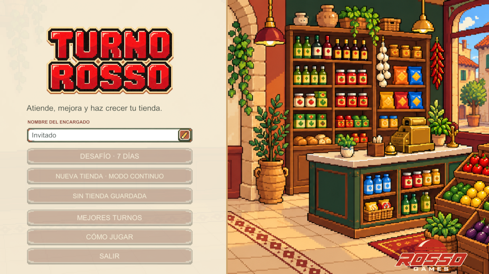
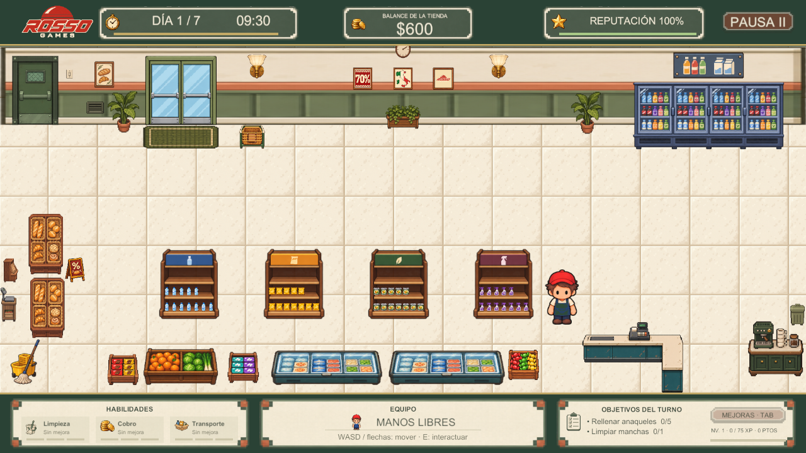
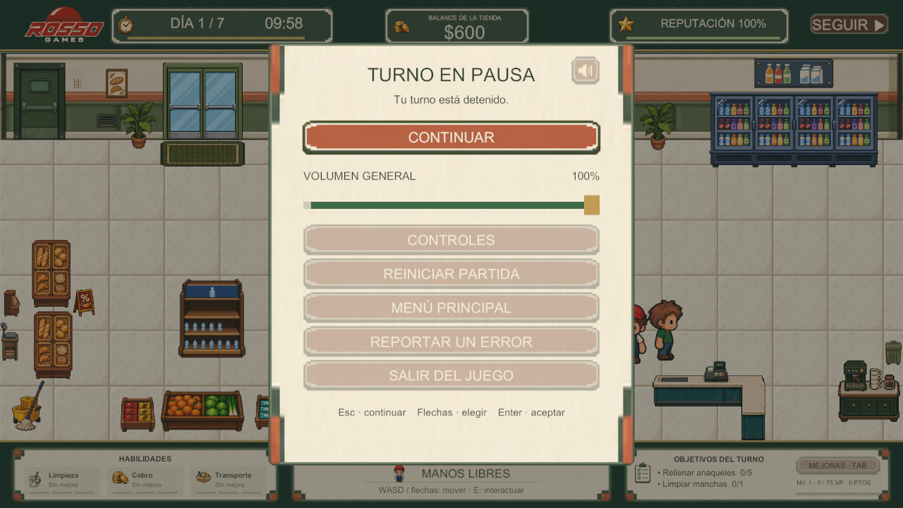
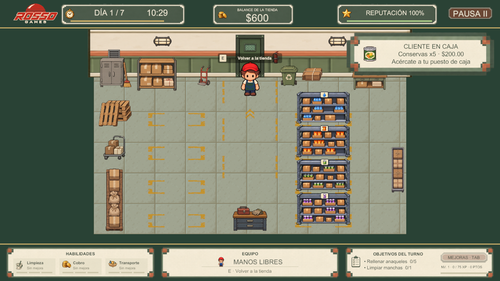
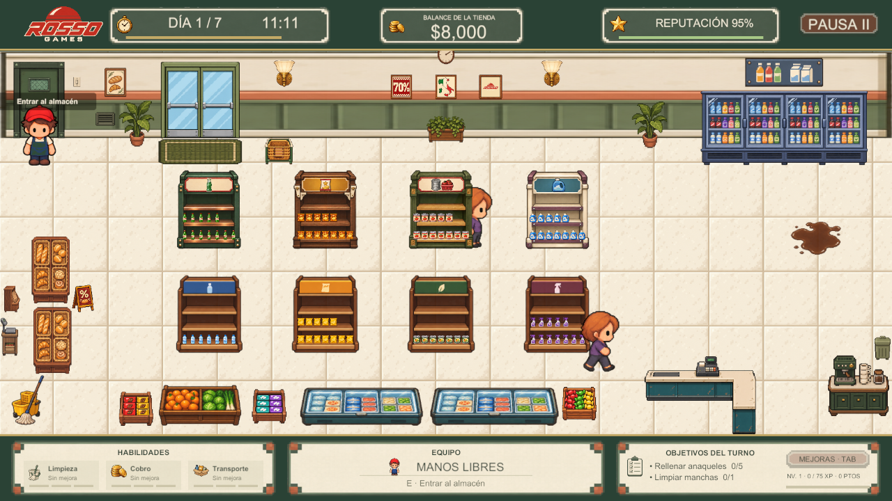
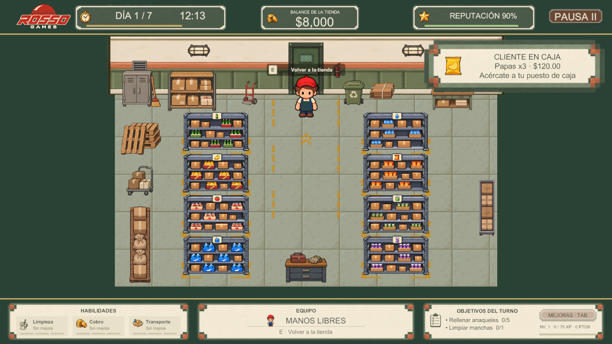
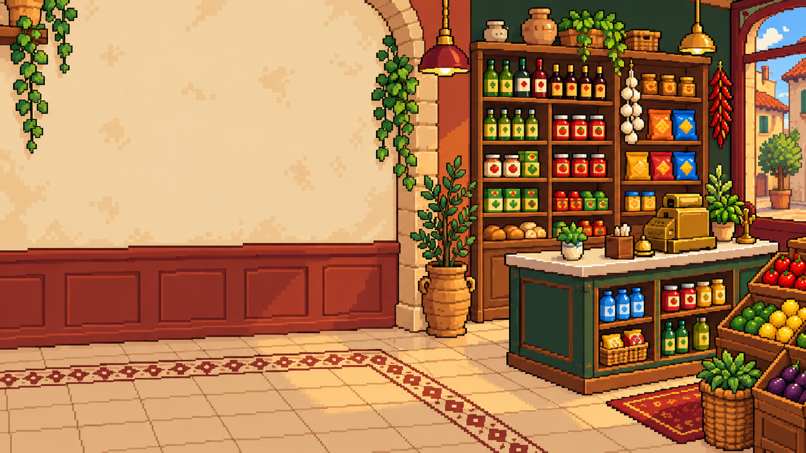

# Registro visual

**Recursos documentados el 9 de noviembre de 2026 · revisión del juego b28eaa1.**

## Procedencia y lectura

Las siguientes imágenes son copias de PNG integrados en el proyecto Unity, identificados por el catálogo de productos y sus recursos de mobiliario. Son previsualizaciones de assets: no capturas nuevas de ejecución ni prueba de su collider o tamaño final en pantalla. El contenido visual de un rack muestra cajas; el inventario real es un dato independiente.

Las animaciones de Personajes y Animación se regeneraron desde los clips activos del proyecto. Se retiraron del GDD las capturas y hojas antiguas que no correspondían a esta revisión.

## Capturas del proyecto en ejecución

Capturadas el **9 de noviembre de 2026** en el Editor Unity 6000.6.4f1, a 1280 × 720, con HUD y UI reales. Se comprobó avance de fotogramas y reloj; no son composiciones del escenario ni capturas de la versión antigua.

### Menú principal

### Tienda al comienzo del desafío

### Menú de pausa

### Bodega inicial

La izquierda permanece vacía hasta desbloquear especialidades. El reloj y la atención de clientes siguieron activos durante el viaje de ida y vuelta por WarehouseDoor.Interact.

### Anaqueles y racks de especialidades

**Condiciones de muestra:** para comprobar los cuatro extras y sus racks en una sola sesión se asignó efectivo temporal en memoria, se ejecutaron BuyShelf/UpgradeShelf y se colocaron 12 unidades en cada extra. No es el estado inicial ni una partida guardada del jugador. La prueba se realizó en desafío y se descartó al salir de Play; no se escribió un punto de control.

## Ocho productos

| Categoría | Producto básico | Especialidad |
| --- | --- | --- |
| Bebidas | ![[Media/Revision_2026-11-09/Agua.png\|64]] Agua | ![[Media/Revision_2026-11-09/Refresco.png\|64]] Refresco |
| Snacks | ![[Media/Revision_2026-11-09/Papas.png\|64]] Papas | ![[Media/Revision_2026-11-09/Gourmet.png\|64]] Gourmet |
| Abarrotes | ![[Media/Revision_2026-11-09/Conservas.png\|64]] Conservas | ![[Media/Revision_2026-11-09/DespensaPlus.png\|64]] Despensa+ |
| Limpieza | ![[Media/Revision_2026-11-09/Limpiador.png\|64]] Limpiador | ![[Media/Revision_2026-11-09/Concentrado.png\|64]] Concentrado |

## Anaqueles de especialidad: sala de ventas

Son los extras mejorados, distintos de los básicos. Las imágenes del mueble vacío no indican que nunca pueda tener existencias: el producto visible se representa con elementos separados.

| Refresco | Gourmet |
| --- | --- |
| ![[Media/Revision_2026-11-09/Anaquel_Refresco.png\|230]] | ![[Media/Revision_2026-11-09/Anaquel_Gourmet.png\|230]] |

| Despensa+ | Concentrado |
| --- | --- |
| ![[Media/Revision_2026-11-09/Anaquel_DespensaPlus.png\|230]] | ![[Media/Revision_2026-11-09/Anaquel_Concentrado.png\|230]] |

## Racks: bodega

Los básicos se distribuyen a la derecha y las especialidades a la izquierda del pasillo central. Los racks de especialidad se habilitan al mejorar el extra correspondiente.

| Producto | Básico | Especialidad |
| --- | --- | --- |
| Bebidas | ![[Media/Revision_2026-11-09/WarehouseRackWater.png\|250]] | ![[Media/Revision_2026-11-09/WarehouseRackSoda.png\|250]] |
| Snacks | ![[Media/Revision_2026-11-09/WarehouseRackChips.png\|250]] | ![[Media/Revision_2026-11-09/WarehouseRackGourmet.png\|250]] |
| Abarrotes | ![[Media/Revision_2026-11-09/WarehouseRackCannedFood.png\|250]] | ![[Media/Revision_2026-11-09/WarehouseRackPantry.png\|250]] |
| Limpieza | ![[Media/Revision_2026-11-09/WarehouseRackCleaner.png\|250]] | ![[Media/Revision_2026-11-09/WarehouseRackConcentrate.png\|250]] |

## Interfaz y utilería

![[Media/Revision_2026-11-09/StudioLogo.png|200]]

Fondo de interfaz: ilustra la tienda; no es el plano de la escena Game ni una promesa de mecánicas para todos los objetos dibujados.

![[Media/Revision_2026-11-09/CheckoutCounterL.png|320]]

![[Media/Revision_2026-11-09/BasketStand.png|320]]

![[Media/Revision_2026-11-09/EntranceBakery.png|320]]

