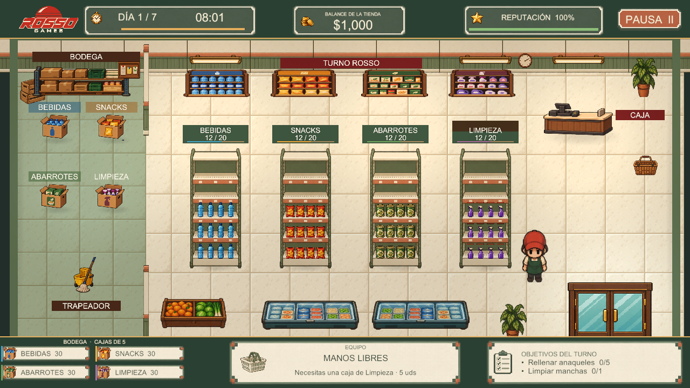
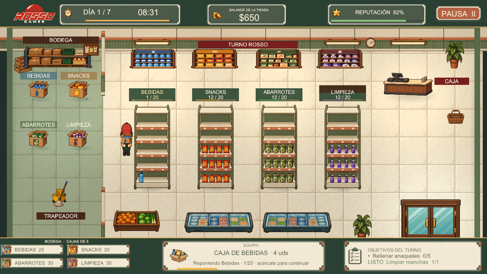
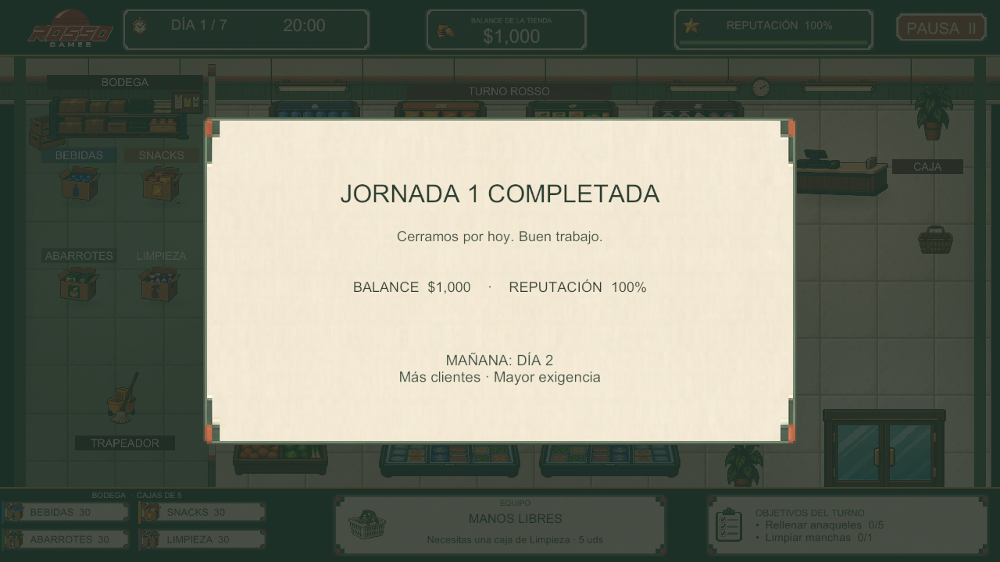
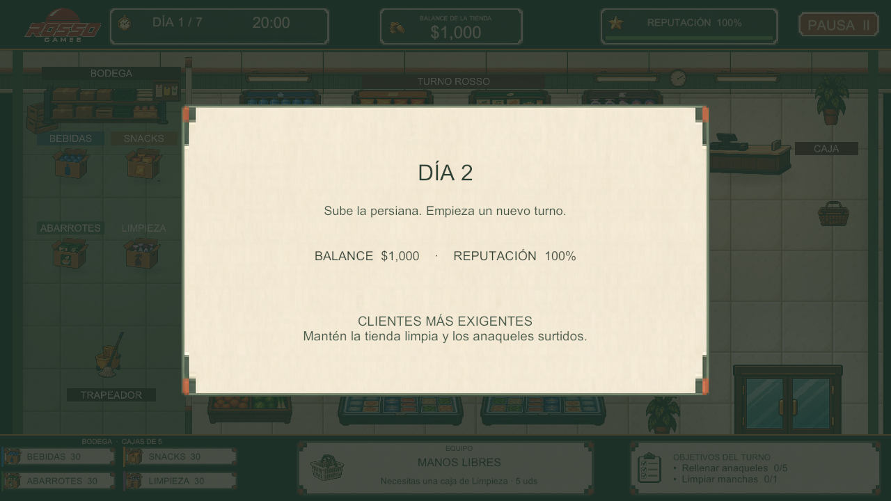
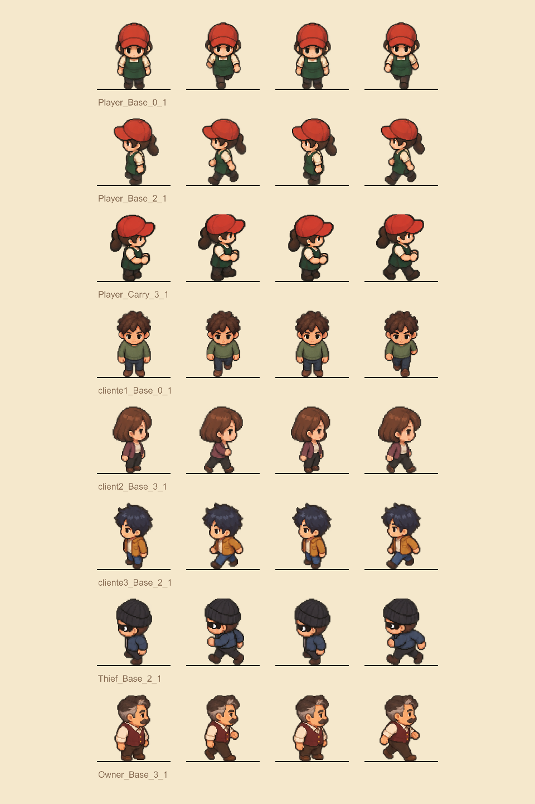

# Referencias e Inspiración

## Referencias utilizadas

| Referencia | Tipo y procedencia | Qué aporta | Límite de uso |
|---|---|---|---|
| Recursos de TurnoRosso-Scripts/Assets | Material proporcionado por el usuario | Base de personajes, objetos e identidad | Revisar procedencia de cada recurso antes de distribución externa |
| Test_Sprites_TR/Assets/Sprites | Proyecto de referencia aportado | Ejemplos de animación del empleado | Mantener recortes y escala; no mezclar poses incompatibles |
| Carpeta “10mo/sprites” | Biblioteca proporcionada por el usuario | Recursos complementarios de personajes y entorno | Registrar autoría/licencia cuando corresponda |
| Imagen de tienda enviada por el usuario | Referencia visual de composición | Pasillos legibles, categorías, caja, bodega e información clara | Referencia de diseño; no se atribuye un título de juego desconocido |
| Capturas del prototipo actual | Evidencia interna | Estado concreto de HUD, tienda, reposición y transición | Reflejan una iteración, no una entrega comercial certificada |
| Logo original ROSSO GAMES proporcionado | Identidad gráfica | Mantener la identidad solicitada | Conservarlo sin rediseño |
| Arte generado para el proyecto | Recursos creados con herramienta de imágenes | Unificar anaqueles, paredes, tarjetas y otros elementos | Revisar consistencia y procedencia en el inventario de recursos |

## Referencias visuales internas

Las imágenes anexas muestran tienda, HUD, reposición y cambio de jornada. No se añaden juegos, autores, enlaces o influencias que el equipo no haya indicado. El repositorio del proyecto está en [[01 - Ficha del Proyecto]].

## Crédito de la estructura documental

La guía de GDD en español fue creada por el **Ing. Luis Fernando Villafaña Rejón**. Su autoría corresponde a la plantilla; los integrantes del juego se encuentran en [[02 - Roles y Responsabilidades]].

> **Navegación:** [[00 - Índice]] · ← [[01 - Glosario]] · [[03 - Registro de Decisiones]] →

## Capturas del prototipo

### Tienda, paredes, anaqueles y HUD

### Reposición con caja de cinco

### Cierre de jornada

### Anuncio del siguiente día

### Poses de caminata

